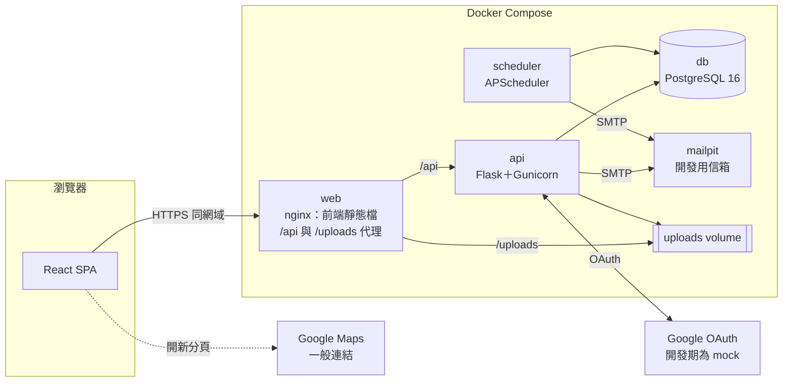

# ARCHITECTURE：系統架構、API 與關鍵設計

> 系統：聚點 空間租借系統｜版本：實作前確認稿 v1（2026-10-28）
> 需求與業務規則見 `docs/PRD.md`（以 BR-xx、FR-xx 引用）；資料結構見 `docs/SCHEMA.md`；類別、方法與互動見 `docs/設計圖_邏輯設計與細部設計.md`；設計取捨見 `docs/設計審查_耦合與內聚.md`。
> v2（2026-10-28）：已套用耦合與內聚審查的 C1～C13 修正。

## 1. 技術棧與選用理由

| 層級 | 選擇 | 用途與理由 | 主要代價 |
|---|---|---|---|
| 後端框架 | Python 3.12、Flask 3 | 課程指定；輕量，以 Blueprint 區分使用者與管理員路由 | 需自行組合套件 |
| ORM／migration | SQLAlchemy 2、Flask-Migrate（Alembic） | ORM 作為 MVC 的 Model；migration 讓 4 人同步資料庫結構 | 排除約束需在 migration 中手寫 |
| 資料庫整合 | Flask-SQLAlchemy 3、psycopg 3（`psycopg[binary]`） | Flask-Migrate 需要 Flask-SQLAlchemy 提供 `db.Model` 與 session；psycopg 3 為 SQLAlchemy 2 建議的 PostgreSQL 驅動 | 多一層封裝 |
| 時區資料 | tzdata | Windows 沒有系統時區資料庫，`zoneinfo` 需要它才能使用 Asia/Taipei | |
| 輸入驗證 | Pydantic 2 | 以型別定義請求與回應格式，錯誤訊息一致 | 與 Flask 需一個小型整合函式 |
| 登入狀態 | Flask-Login＋Flask 簽章 cookie session | 伺服器簽章、HttpOnly cookie，比 localStorage 的 JWT 更能防 XSS 竊取 | 前後端須同網域（nginx 代理解決） |
| CSRF | Flask-WTF `CSRFProtect` | 標準防護；前端從 `/api/v1/auth/csrf` 取得 token 放在 `X-CSRFToken` 標頭 | 每個修改請求都要帶標頭 |
| Google OAuth | Authlib | 成熟的 OAuth／OIDC 用戶端，驗證 id_token | 需 Google Cloud 憑證（開發期以 mock 代替） |
| 限流 | Flask-Limiter | 登入、註冊、忘記密碼防暴力嘗試 | |
| 排程 | APScheduler（獨立 `scheduler` 容器） | 輕量；獨立容器避免多個 API worker 重複執行 | 單一排程程序，課程規模足夠 |
| 寄信 | Python `smtplib`；開發用 Mailpit | 不綁特定服務；Mailpit 提供網頁介面檢視測試信 | |
| 應用伺服器 | Gunicorn | 正式的 WSGI 伺服器 | |
| 資料庫 | PostgreSQL 16（`btree_gist`） | 排除約束防止重複預約，併發下仍正確 | 組員需熟悉少量 PostgreSQL 語法 |
| 前端 | React 18、Vite、TypeScript | 課程指定 React；Vite 啟動快；TypeScript 讓 API 型別在編譯期就檢查 | 學習 TypeScript |
| 路由 | React Router 6 | 標準路由，支援受保護路由 | |
| 伺服器狀態 | TanStack Query 5 | 處理 API 快取、載入、錯誤、重新整理，減少自寫狀態管理 | |
| 表單 | React Hook Form＋Zod | 前端驗證規則與 TypeScript 型別共用 | |
| UI 元件 | Mantine 7（`@mantine/core`、`hooks`、`notifications`） | 元件完整、內建無障礙、主題易客製。日期選擇使用瀏覽器原生 `<input type="date">`（手機體驗佳、可鍵盤操作），因此未引入 `@mantine/dates` | 套件體積較大 |
| 日期 | dayjs（含 timezone 外掛） | 一律以 Asia/Taipei 顯示 | |
| 測試 | pytest、pytest-cov；Vitest、Testing Library；Playwright | 後端單元與整合測試、前端元件測試、端對端測試 | |
| 壓力測試 | Locust | Python 撰寫情境，與後端同語言 | |
| 容器 | Docker Compose | 課程指定；一個指令啟動全部服務 | Windows 需 WSL2 |

## 2. 系統架構



| 服務 | 映像／內容 | 對外連接埠 |
|---|---|---|
| web | nginx＋前端 build 結果 | 8080 |
| api | Flask＋Gunicorn（3 workers） | 不對外（經 web 代理） |
| scheduler | 與 api 同映像，指令 `flask run-scheduler` | 不對外 |
| db | postgres:16 | 5432（僅開發） |
| mailpit | axllent/mailpit | 8025（網頁信箱） |

## 3. MVC 與分層

| MVC | 實作位置 | 職責 |
|---|---|---|
| Model | `backend/app/models/`（SQLAlchemy） | 資料表對應、關聯；不放商業邏輯 |
| Controller | `backend/app/blueprints/`（Flask Blueprint） | 解析請求、Pydantic 驗證、呼叫 service、轉換回應；不寫商業規則 |
| View | `frontend/`（React） | 畫面與互動、前端輸入驗證；不做權限與金額判斷 |
| Service | `backend/app/services/` | 協調流程、交易邊界、權限與資料所有權檢查；回傳 DTO（`schemas/` 的 Pydantic 模型），ORM 物件不離開 Service 層 |
| Policy | `backend/app/policies/` | 不碰資料庫的純函式業務規則：`PricingPolicy`（金額、改期價差，BR-07、14）、`RefundPolicy`（退款比例與金額，BR-12、13）。試算 API 與正式流程呼叫同一個函式 |

規則：

1. Controller 不寫商業規則；跨表的寫入只能在 Service 中、以單一交易完成。課程規模不另設 repository 層，查詢寫在 Service 內，重複的查詢抽成 model 上的 classmethod。
2. **訂單相關的寫入（bookings、booking_status_logs、退款）只能經過 `BookingService`**；其他 Service 與排程需要改訂單時，呼叫 `BookingService` 的公開方法。
3. **訂單狀態只能透過 `Booking.transition()` 改變**，它依 D10 狀態圖檢查轉換是否合法並產生狀態紀錄；改期與部分退款不改狀態，以 `Booking.record()` 寫紀錄。
4. `PaymentService` 只負責模擬金流與寫入 payments，不依賴其他 Service。
5. 公開方法不使用布林旗標切換行為；會員與管理員規則不同時，提供兩個語意明確的方法（例如 `cancel_by_member`、`cancel_by_admin`），共用私有核心。
6. Service 不直接讀系統時間，一律透過注入的 `Clock`（`utils/clock.py`），測試時替換成固定時間。

各模組與 Service 的完整相依見 `docs/設計圖_邏輯設計與細部設計.md` 的 L3 與 D3。

## 4. 目錄結構

```text
.
├── CLAUDE.md
├── docker-compose.yml
├── .env.example
├── backend/
│   ├── Dockerfile
│   ├── pyproject.toml
│   ├── app/
│   │   ├── __init__.py          # create_app()
│   │   ├── config.py            # 從環境變數讀設定
│   │   ├── extensions.py        # db、migrate、login_manager、csrf、limiter
│   │   ├── models/              # 每張表一個檔
│   │   ├── schemas/             # Pydantic 請求與回應
│   │   ├── services/            # auth、password、google_auth、catalog、availability、
│   │   │                        # booking、payment、access_code、review、favorite、
│   │   │                        # notification、admin_catalog、admin_booking、admin_user
│   │   ├── policies/            # pricing、refund（純函式）
│   │   ├── blueprints/          # auth、catalog、me、bookings、admin、dev
│   │   ├── jobs/                # 排程工作
│   │   ├── security/            # 密碼雜湊、權杖、權限裝飾器
│   │   ├── mail/                # 信件範本與寄送
│   │   ├── errors.py            # 例外類別、錯誤碼與 HTTP 狀態碼對照、統一錯誤回應
│   │   └── utils/               # time.py：UTC 與 Asia/Taipei 轉換；clock.py：可替換的時鐘
│   ├── migrations/
│   ├── seed.py
│   └── tests/
│       ├── unit/                # service 單元測試
│       ├── api/                 # 透過 Flask test client 的 API 測試
│       ├── concurrency/         # 使用實際 PostgreSQL 的併發測試
│       └── load/                # Locust 腳本
├── frontend/
│   ├── Dockerfile               # 建置後交給 nginx
│   ├── nginx.conf
│   └── src/
│       ├── api/                 # API 用戶端與型別
│       ├── components/          # 共用元件（SlotGrid、SpaceCard、PriceSummary…）
│       ├── features/            # auth、spaces、bookings、favorites、admin
│       ├── pages/               # 對應 PRD 7 節的頁面
│       ├── hooks/
│       ├── routes.tsx           # 路由與受保護路由
│       └── theme.ts             # Mantine 主題（PRD 8 節色彩）
├── e2e/                         # Playwright
└── docs/
    ├── PRD.md
    ├── SCHEMA.md
    ├── ARCHITECTURE.md
    ├── sql/schema.sql
    ├── 設計圖_邏輯設計與細部設計.md
    ├── 設計審查_耦合與內聚.md
    ├── 圖檔/                    # 設計圖 PNG
    ├── ai-usage-log.md
    └── course/                  # 課程文件 (a)–(g)
```

## 5. API

### 5.1 共用約定

- 前綴 `/api/v1`；JSON；時間以 ISO 8601 含時區（`2026-11-20T14:00:00+08:00`）。
- 修改請求（POST、PUT、PATCH、DELETE）必須帶 `X-CSRFToken`。
- 分頁：`?page=1&page_size=12`，回應含 `items`、`page`、`page_size`、`total`。
- 錯誤回應統一格式：

```json
{ "error": { "code": "SLOT_TAKEN", "message": "此時段已被預約，請選擇其他時段", "details": {} } }
```

錯誤碼完整清單（新增錯誤碼須先更新本表）。Service 只拋出帶錯誤碼的例外，不知道 HTTP；錯誤碼與 HTTP 狀態碼的對照放在 `errors.py`，由 Controller 層的全域錯誤處理器轉換：

| HTTP | 錯誤碼 | 情況 |
|---|---|---|
| 400 | `VALIDATION_ERROR` | 格式或欄位驗證失敗（details 列出欄位） |
| 400 | `TOKEN_INVALID` | 驗證、重設、設定密碼的權杖無效、過期或已使用 |
| 400 | `INVALID_UPLOAD` | 照片格式或大小不符 |
| 401 | `UNAUTHENTICATED` | 未登入 |
| 401 | `INVALID_CREDENTIALS` | 帳號或密碼錯誤；變更密碼時舊密碼錯誤 |
| 403 | `FORBIDDEN` | 角色不符（非管理員）；CSRF 驗證失敗 |
| 403 | `ACCOUNT_RESTRICTED` | 帳號 FROZEN 或 BLACKLISTED，不能預約、付款、改期 |
| 403 | `EMAIL_NOT_VERIFIED` | email 未驗證，不能預約 |
| 404 | `NOT_FOUND` | 不存在或不屬於本人（不透露存在與否） |
| 409 | `SLOT_TAKEN` | 違反排除約束，時段已被預約 |
| 409 | `BOOKING_EXPIRED` | 付款時已超過付款期限 |
| 409 | `INVALID_STATE` | 訂單狀態不允許此操作 |
| 409 | `PENDING_LIMIT` | 待付款訂單已達 3 筆 |
| 409 | `IDEMPOTENCY_KEY_REUSED` | 冪等鍵已用於其他訂單 |
| 409 | `ACCOUNT_ALREADY_LINKED` | 帳號已綁定另一個 Google 帳號 |
| 422 | `INVALID_TIME_SLOT` | 非整點、跨日、結束不晚於開始 |
| 422 | `OUTSIDE_OPENING_HOURS` | 超出場館營業時間 |
| 422 | `OUT_OF_RANGE` | 早於下一個整點或超過 60 天 |
| 422 | `OVER_CAPACITY` | 人數超過容量 |
| 422 | `SPACE_UNAVAILABLE` | 空間非 AVAILABLE 或場館非 OPEN |
| 422 | `RESCHEDULE_NOT_ALLOWED` | 不符改期條件（24 小時、次數、管理員改期時數不同） |
| 422 | `REFUND_EXCEEDS_PAID` | 退款總額超過實收 |
| 422 | `REVIEW_NOT_ALLOWED` | 非已完成訂單、超過 30 天、或已評論 |
| 422 | `PASSWORD_TOO_WEAK` | 密碼不符 BR-22 |
| 423 | `ACCOUNT_LOCKED` | 登入失敗次數過多（details 含解鎖時間） |
| 429 | `RATE_LIMITED` | 限流 |

**付款失敗不是錯誤回應**：`POST /bookings/{id}/pay` 在模擬卡片遭拒時回傳 200，內容為 `{"status": "FAILED", "reason": "CARD_DECLINED", ...}`，訂單維持待付款，前端顯示可重付。

### 5.2 端點清單

權限：公開＝不需登入；會員＝已登入；本人＝資源須屬於登入者；管理員＝ADMIN。

**auth（帳號）**

| 方法 | 路徑 | 權限 | 說明 | FR |
|---|---|---|---|---|
| GET | `/auth/csrf` | 公開 | 取得 CSRF token | |
| POST | `/auth/register` | 公開 | 註冊 | FR-01 |
| POST | `/auth/verify-email` | 公開 | 以權杖驗證 email | FR-02 |
| POST | `/auth/resend-verification` | 公開 | 以 email 重寄驗證信；不論 email 是否存在都回傳相同訊息 | FR-02 |
| POST | `/auth/login` | 公開 | 登入 | FR-03 |
| POST | `/auth/logout` | 會員 | 登出 | FR-03 |
| GET | `/auth/me` | 公開 | 目前登入者（未登入回傳 null） | |
| POST | `/auth/forgot-password` | 公開 | 寄送重設信 | FR-05 |
| POST | `/auth/reset-password` | 公開 | 以權杖重設密碼 | FR-05 |
| POST | `/auth/set-password` | 公開 | 以權杖設定本地密碼 | FR-06 |
| GET | `/auth/google/start` | 公開 | 導向 Google（開發模式導向 mock） | FR-04 |
| GET | `/auth/google/callback` | 公開 | Google 回呼 | FR-04 |
| POST | `/auth/google/link` | 公開 | 情況③：輸入既有帳號密碼後綁定；待綁定的 Google 身分存在 session，10 分鐘內有效 | FR-04 |

**me（本人）**

| 方法 | 路徑 | 權限 | 說明 | FR |
|---|---|---|---|---|
| PATCH | `/me` | 會員 | 修改姓名、電話 | FR-07 |
| PUT | `/me/password` | 會員 | 變更密碼 | FR-08 |
| POST | `/me/password/setup-email` | 會員 | 只用 Google 登入者申請設定密碼信 | FR-06 |
| GET | `/me/bookings?tab=` | 會員 | 我的訂單 | FR-30 |
| GET | `/me/favorites` | 會員 | 收藏清單 | FR-15 |
| PUT／DELETE | `/me/favorites/{space_id}` | 會員 | 收藏、取消收藏（冪等） | FR-15 |

**catalog（公開目錄）**

| 方法 | 路徑 | 權限 | 說明 | FR |
|---|---|---|---|---|
| GET | `/catalog/filters` | 公開 | 縣市與行政區、空間類型、設備選項 | FR-10 |
| GET | `/spaces` | 公開 | 搜尋：`city`、`district`、`people`、`min_price`、`max_price`、`type`、`equipment`（可多個）、`date`＋`start`＋`end`、`lat`＋`lng`、`sort` | FR-10～12 |
| GET | `/spaces/{id}` | 公開 | 空間詳細 | FR-13 |
| GET | `/spaces/{id}/availability?date=` | 公開 | 該日每小時時段狀態 | FR-14 |
| GET | `/spaces/{id}/reviews` | 公開 | 評論（不含隱藏者） | FR-13 |

**bookings（訂單）**

| 方法 | 路徑 | 權限 | 說明 | FR |
|---|---|---|---|---|
| POST | `/bookings/quote` | 會員 | 試算金額與檢查規則，不建立訂單 | FR-20 |
| POST | `/bookings` | 會員 | 建立訂單 | FR-21 |
| GET | `/bookings/{id}` | 本人 | 訂單詳細（含付款、房間密碼狀態） | FR-31 |
| POST | `/bookings/{id}/pay` | 本人 | 模擬付款；標頭 `Idempotency-Key` 必填 | FR-22 |
| GET | `/bookings/{id}/cancel-quote` | 本人 | 預計退款金額 | FR-32 |
| POST | `/bookings/{id}/cancel` | 本人 | 取消 | FR-32 |
| POST | `/bookings/{id}/reschedule-quote` | 本人 | 新時段的價差試算 | FR-33 |
| POST | `/bookings/{id}/reschedule` | 本人 | 改期；需補付時 body 帶 `method`，標頭帶 `Idempotency-Key` | FR-33 |
| POST | `/bookings/{id}/review` | 本人 | 撰寫評論 | FR-34 |

**admin（管理員）**

| 方法 | 路徑 | 說明 | FR |
|---|---|---|---|
| GET／POST | `/admin/branches` | 列表、新增 | FR-40 |
| PATCH | `/admin/branches/{id}` | 修改 | FR-40 |
| POST | `/admin/branches/{id}/status` | 停用或啟用；回傳受影響訂單 | FR-40 |
| GET／POST | `/admin/spaces` | 列表、新增 | FR-41 |
| GET／PATCH | `/admin/spaces/{id}` | 詳細、修改 | FR-41 |
| POST | `/admin/spaces/{id}/status` | 切換狀態；回傳受影響訂單 | FR-41 |
| POST | `/admin/spaces/{id}/photos` | 上傳照片（multipart） | FR-42 |
| PUT | `/admin/spaces/{id}/photos/order` | 排序 | FR-42 |
| PATCH／DELETE | `/admin/photos/{photo_id}` | 修改說明、刪除 | FR-42 |
| GET／POST | `/admin/equipment` | 設備清單、新增 | FR-43 |
| PATCH | `/admin/equipment/{id}` | 修改、停用 | FR-43 |
| PUT | `/admin/spaces/{id}/equipment` | 整批設定空間設備 | FR-43 |
| GET | `/admin/bookings` | 查詢：`no`、`email`、`space_id`、`from`、`to`、`status` | FR-44 |
| GET | `/admin/bookings/{id}` | 詳細：付款、狀態紀錄、房間密碼、通知 | FR-44 |
| POST | `/admin/bookings/{id}/cancel` | 取消（原因必填，全額退款） | FR-45 |
| POST | `/admin/bookings/{id}/reschedule` | 代為改期 | FR-45 |
| POST | `/admin/bookings/{id}/refunds` | 部分退款；標頭 `Idempotency-Key` 必填 | FR-45 |
| GET | `/admin/users` | 會員查詢 | FR-46 |
| PATCH | `/admin/users/{id}/status` | 凍結、黑名單、解除（原因必填） | FR-46 |
| GET | `/admin/reviews` | 評論列表 | FR-47 |
| PATCH | `/admin/reviews/{id}` | 隱藏或取消隱藏 | FR-47 |
| GET | `/admin/notifications` | 通知紀錄 | FR-48 |
| POST | `/admin/notifications/{id}/retry` | 重寄 | FR-48 |
| GET | `/admin/summary` | 後台首頁數字 | |

**dev（僅 `APP_ENV=development` 註冊）**

| 方法 | 路徑 | 說明 |
|---|---|---|
| GET | `/dev/google-mock` | 假的 Google 登入頁：選擇或輸入測試身分（sub、email、email_verified）後回呼 |

## 6. 關鍵交易與併發處理

所有寫入流程在 Service 中以單一資料庫交易完成；寄信等外部動作在交易**提交後**才執行，失敗不影響訂單結果，只記錄於 notification_logs。以下流程的主控者都是 `BookingService`（第 3 節規則 2）。

### 6.1 建立訂單（FR-21）：`BookingService.create()`

1. 以 `SELECT ... FOR UPDATE` 鎖定使用者列（防止同一人併發突破上限）。
2. 將「該使用者」與「該空間」中已逾時（`expires_at <= now()`）的待付款訂單轉為 EXPIRED，並寫狀態紀錄（BR-08）。
3. 計算該使用者 `status = 'PENDING_PAYMENT' AND expires_at > now()` 的筆數（BR-06）。
4. 檢查 BR-01、02、04、05；以 `PricingPolicy` 計算金額（BR-07）。
5. INSERT 訂單；`Booking.transition()` 產生 CREATE 狀態紀錄。
6. 若違反排除約束 `ex_bookings_no_overlap`，回滾並回傳 409 `SLOT_TAKEN`。

正確性由第 6 步的資料庫約束保證；第 2 步只是為了即時釋出逾時時段與正確計算上限，不負責防重疊。

### 6.2 付款（FR-22）：`BookingService.pay()`

1. `SELECT ... FOR UPDATE` 鎖定訂單（先鎖再查冪等鍵，避免同一鍵的併發請求同時通過檢查）。
2. 查詢 `Idempotency-Key`：已存在且屬於同一訂單 → 直接回傳該筆結果；屬於其他訂單 → 409 `IDEMPOTENCY_KEY_REUSED`。
3. 檢查狀態為 PENDING_PAYMENT、帳號狀態（BR-05）、空間與場館仍可預約（BR-18）。已逾期則 `transition(EXPIRED)` 並**提交**，再回傳 409 `BOOKING_EXPIRED`。
4. 呼叫 `PaymentService.charge()`：模擬金流（測試卡號 `4000 0000 0000 0002` 失敗，其餘成功）並寫入 payments，回傳成功或失敗；PaymentService 不碰訂單。
5. 成功：`transition(CONFIRMED, PAY)`、`AccessCodeService.issue()`、`NotificationService.enqueue()`；失敗：訂單維持待付款，回傳 200 與 `CARD_DECLINED`。
6. 提交後寄送確認信。若 INSERT 仍因冪等鍵唯一約束失敗（極少見的競爭），回滾後依第 2 步回傳既有結果。

付款與逾時排程競爭同一筆訂單時，兩者都先鎖定訂單列，先取得鎖的一方生效，另一方看到已變更的狀態而放棄。

### 6.3 取消（FR-32、FR-45）：`BookingService.cancel_by_member()`、`cancel_by_admin()`

1. 鎖定訂單；已是 CANCELLED 時直接回傳原結果（冪等）。
2. 以 `RefundPolicy` 計算退款：會員依 BR-12，管理員依 BR-13（100%），以實收金額為基準。兩個公開方法只差在比例與「原因是否必填」，共用私有 `_cancel()`。
3. `PaymentService.refund()` 新增 REFUND（金額 > 0 時；method 沿用原付款；冪等鍵 `refund-cancel-{booking_id}`）、寫入取消者、原因與時間、`transition(CANCELLED)`、`AccessCodeService.revoke()`、建立通知。

### 6.4 改期（FR-33、FR-45）：`BookingService.reschedule_by_member()`、`reschedule_by_admin()`

1. 鎖定訂單。若訂單已是請求的新時段，直接回傳成功（重送請求的冪等處理）。
2. `reschedule_by_member()` 檢查 BR-14（狀態、原訂單開始前 24 小時、次數）；`reschedule_by_admin()` 檢查 BR-19（時數相同）；兩者共用私有 `_reschedule()`，都檢查新時段的 BR-01、02、04。價差由 `PricingPolicy` 計算。
3. 更新 start_at、end_at、total_amount（以原時租快照重算）；會員改期另將 reschedule_count 加 1。若新時段與他人重疊，排除約束拋錯，整個交易回滾，原訂單不變。
4. 價差 > 0：在同一交易中以請求的 method 執行模擬付款（冪等鍵取自標頭），卡片遭拒則整個交易回滾，回傳 422 `RESCHEDULE_NOT_ALLOWED`（details 註明 `CARD_DECLINED`），原訂單不變；價差 < 0：新增 REFUND（冪等鍵 `refund-resched-{booking_id}`）。
5. `AccessCodeService.sync_validity()` 更新房間密碼有效時間；`Booking.record(RESCHEDULE)` 寫紀錄，reason 記錄「原時段 → 新時段」；建立通知。

### 6.5 管理員部分退款（FR-45、BR-17）：`BookingService.refund_partially()`

1. 鎖定訂單；`Idempotency-Key` 已存在且屬於同一訂單時回傳原結果。
2. 檢查退款後的退款總額不超過實收（`REFUND_EXCEEDS_PAID`）。
3. `PaymentService.refund()` 新增 REFUND；`Booking.record(REFUND)` 寫紀錄，訂單狀態不變。

`AdminBookingService` 只負責查詢（列表與詳細），不寫入任何資料。

### 6.6 排程

| 工作 | 實作 | 冪等方式 |
|---|---|---|
| 逾時轉 EXPIRED | 呼叫 `BookingService.expire_overdue()`：以 `FOR UPDATE SKIP LOCKED` 取出逾時的待付款訂單，逐筆 `transition(EXPIRED)` | 條件式查詢，重跑不影響已處理者 |
| 自動完成 | 呼叫 `BookingService.complete_finished()`：取出 `end_at <= now()` 的已確認訂單，逐筆 `transition(COMPLETED)` | 同上 |
| 清理房間密碼、權杖 | 呼叫 `AccessCodeService.purge_expired()`、`PasswordService.purge_tokens()`，依時間條件 DELETE | 同上 |
| 久未登入凍結 | 呼叫 `AdminUserService.freeze_inactive()`：條件式 UPDATE `role='USER' AND status='ACTIVE' AND COALESCE(last_login_at, created_at) < now() - interval '180 days'`，寫入原因 | 同上 |
| 重試通知 | 呼叫 `NotificationService.retry_failed()`：`SELECT ... FOR UPDATE SKIP LOCKED` 取 FAILED 且 attempts < 3 者 | 鎖定避免重複寄送 |

排程程式（`jobs/`）每個工作只呼叫一個 Service 方法，本身不寫商業邏輯。

APScheduler 設定 `max_instances=1`、`coalesce=True`，同一工作不會重疊執行。

## 7. 安全設計

| 項目 | 做法 |
|---|---|
| 密碼 | `hashlib.pbkdf2_hmac('sha256', 密碼, salt, 600000)`；salt 以 `secrets.token_bytes(16)` 產生；比對使用 `hmac.compare_digest` |
| 權杖 | `secrets.token_urlsafe(32)` 產生，資料庫只存 SHA-256；單次使用 |
| 房間密碼 | `secrets.randbelow(10**6)` 補零成 6 位 |
| Session | `SESSION_COOKIE_HTTPONLY=True`、`SAMESITE='Lax'`、正式環境 `SECURE=True`；登入時更新 session 防固定攻擊 |
| 權限 | 裝飾器 `@login_required`、`@admin_required`；資料所有權在 service 檢查，不屬於本人一律回 404 |
| 帳號列舉 | 註冊、忘記密碼的回應不透露 email 是否存在 |
| 上傳 | 檢查副檔名與檔案標頭、大小 ≤ 5 MB、以 UUID 重新命名，存於 uploads volume，由 nginx 以靜態檔提供 |
| 機密 | 全部放 `.env`（不進版控），提供 `.env.example` |

## 8. Google 登入與寄信的替代方案

| 服務 | 開發與 demo | 正式設定 |
|---|---|---|
| Google 登入 | `GOOGLE_MOCK=true` 時，「Google 登入」導向 `/api/v1/dev/google-mock`，可模擬三種情況（FR-04 ①②③） | Google Cloud Console 建立 OAuth 用戶端，重新導向 URI 設為 `http://localhost:8080/api/v1/auth/google/callback`，填入 `GOOGLE_CLIENT_ID`、`GOOGLE_CLIENT_SECRET`，並設 `GOOGLE_MOCK=false` |
| 寄信 | 所有信寄到 Mailpit，在 `http://localhost:8025` 檢視 | 設定 `SMTP_HOST=smtp.gmail.com`、`SMTP_PORT=587`、Gmail 帳號與應用程式密碼 |

## 9. 環境變數（`.env.example`）

```dotenv
APP_ENV=development
SECRET_KEY=change-me
DATABASE_URL=postgresql+psycopg://app:app@db:5432/judian
APP_BASE_URL=http://localhost:8080
TZ_DISPLAY=Asia/Taipei
SMTP_HOST=mailpit
SMTP_PORT=1025
SMTP_USER=
SMTP_PASSWORD=
MAIL_FROM=聚點 <no-reply@judian.local>
SUPPORT_EMAIL=support@judian.local
GOOGLE_MOCK=true
GOOGLE_CLIENT_ID=
GOOGLE_CLIENT_SECRET=
UPLOAD_DIR=/data/uploads
```

## 10. 測試策略

| 層級 | 工具 | 重點 |
|---|---|---|
| 單元 | pytest | 每條 BR 至少一個成功與一個失敗案例；`PricingPolicy`、`RefundPolicy` 的邊界值（不需資料庫）；`Booking.transition()` 的所有合法與不合法轉換；以固定時間的 `Clock` 測試時間相關規則 |
| API | pytest＋Flask test client | 權限（未登入、非本人、非管理員）、錯誤碼、CSRF |
| 併發 | pytest＋實際 PostgreSQL＋多執行緒 | 同時段 20 筆併發預約只成立 1 筆；同一訂單併發付款只成功 1 次；付款與逾時排程競爭；同一人併發突破待付款上限 |
| 前端 | Vitest＋Testing Library | 時段格選取、表單驗證、錯誤狀態顯示 |
| 端對端 | Playwright | 完整流程：註冊 → 驗證 → 搜尋 → 預約 → 付款 → 取消；管理員停用空間並取消受影響訂單 |
| 壓力 | Locust | 搜尋 100 位併發使用者；同時段搶訂 |

測試資料庫使用 Compose 中的 PostgreSQL（獨立的 `judian_test` 資料庫），每個測試以交易回滾或重建資料表隔離。未實際執行的測試不得在報告中標示為通過。

## 11. 開發與部署指令

```bash
cp .env.example .env
docker compose up --build -d
docker compose exec api flask db upgrade
docker compose exec api flask seed
# 前台與後台：http://localhost:8080　測試信箱：http://localhost:8025

docker compose exec api pytest
cd frontend && npm install && npm test          # 前端單元測試（本機需 Node.js 20 以上）
npm run dev                                     # 前端開發伺服器，Vite 將 /api 代理到 localhost:8080
cd ../e2e && npx playwright test                # 端對端測試（系統需先啟動）
```

種子資料的測試帳號（密碼皆為 `Passw0rd!`）：

| 帳號 | 角色與狀態 | 用途 |
|---|---|---|
| admin@judian.local | ADMIN | 管理後台 |
| user1@judian.local、user2@judian.local | USER，已驗證 | 一般流程 |
| unverified@judian.local | USER，未驗證 | 驗證 email 流程 |
| frozen@judian.local | USER，FROZEN | 帳號限制 |
| blacklisted@judian.local | USER，BLACKLISTED | 帳號限制 |
| Google mock：sub `google-001`、`g1@gmail.com` | 只用 Google 登入 | FR-04、FR-06 |
