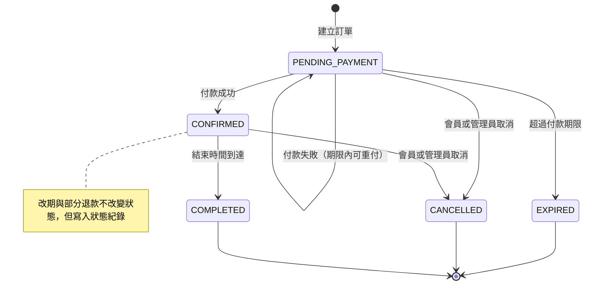
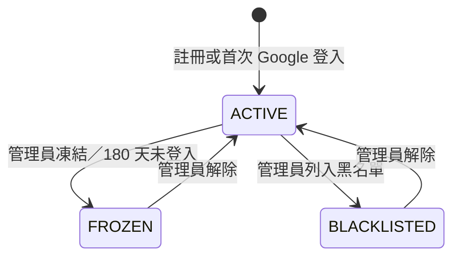
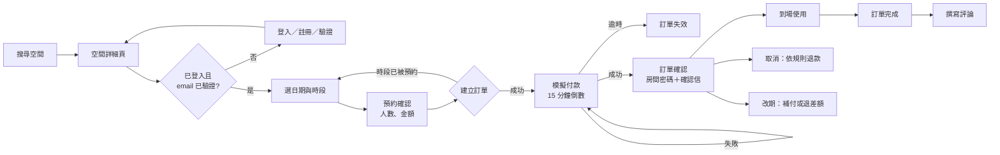

# PRD：需求與業務規則

> 系統：聚點 空間租借系統｜版本：實作前確認稿 v1（2026-10-28）
> 需求依據：「專案討論內容.md」（主要）、「User Story.md」（補充）、《實作前需求釐清（第一輪，已決議）》。
> 資料結構見 `docs/SCHEMA.md`；技術架構與 API 見 `docs/ARCHITECTURE.md`。

## 1. 產品概述

讀書會、小組討論、聚會、慶生、工作坊常受到餐廳或公共場所的用餐時間、外食、布置、設備與隱私限制。「聚點」讓使用者依地區、人數、價格、設備與時段搜尋合適空間，線上預約並模擬付款，取得訂單專屬的房間密碼後自助入場；管理員在後台維護場館、空間、訂單與會員。

**期中檢核（11/18）**：所有必做功能可從頭到尾操作；外部服務以 Mailpit 與 Google mock 代替。
**期末 demo（12/16）**：補齊測試、錯誤狀態處理、介面細節與選做項目。

## 2. 範圍

| 類別 | 項目 |
|---|---|
| 必做 | 帳號（註冊、email 驗證、登入登出、Google 登入、忘記密碼、修改資料與密碼、Google 帳號設定本地密碼）、搜尋（地區、價格、人數、類型、設備、日期時段、定位附近）、空間詳細頁（照片、設備、規定、進入方式、評論、收藏、Google Maps）、訂單（建立、模擬付款、查看、取消與退款、改期、歷史）、房間密碼、確認信、評論、管理後台（場館、空間、照片、設備、訂單、退款、會員、評論、通知）、排程 |
| 選做（納入） | 久未登入自動凍結、搜尋結果依價格或容量排序 |
| 後續擴充（不做） | 每週不同營業時間、平假日定價、營運統計、維修封鎖時段、各空間不同取消規則、最低租借時數設定、地圖檢視、管理員日曆、重寄確認信（會員端）、登入後綁定 Google（US-20） |
| 不做 | 真實金流、實體門鎖串接、原生 App、多語系、多租戶 |

房間密碼為模擬門禁，系統不宣稱能操作實體門鎖。

## 3. 角色與權限

| 功能 | 訪客 | 會員（USER） | 管理員（ADMIN） |
|---|---|---|---|
| 搜尋、瀏覽空間與評論 | ✓ | ✓ | ✓ |
| 收藏、預約、付款、我的訂單、評論 | | ✓（需 email 已驗證、狀態 ACTIVE 才能新預約） | |
| 修改個人資料與密碼 | | ✓ | ✓ |
| 管理後台 | | | ✓ |

- 會員只能存取自己的訂單、房間密碼、收藏與評論；後端以資料所有權檢查，不只靠前端隱藏。
- 管理員帳號由種子資料或資料庫建立，不開放註冊為管理員。
- FROZEN、BLACKLISTED 會員可以登入查看既有訂單，但不能新預約、付款或改期；可以取消自己的訂單。

## 4. 業務規則

| 編號 | 規則 |
|---|---|
| BR-01 | 租借以 1 小時為單位，整點開始，連續時段；不跨日，須在場館當日營業時間內 |
| BR-02 | 可預約範圍：從下一個整點起，到 60 天內 |
| BR-03 | 同一空間的待付款與已確認訂單時段不可重疊；相鄰時段（例如 10–12 與 12–13）不算重疊。由資料庫排除約束保證 |
| BR-04 | 使用人數不可超過空間容量；空間須為 AVAILABLE、場館須為 OPEN |
| BR-05 | 新預約、付款、改期須：帳號 ACTIVE 且 email 已驗證 |
| BR-06 | 每人同時最多 3 筆待付款訂單 |
| BR-07 | 金額由後端計算：時租 × 時數，下訂時快照；之後調價不影響既有訂單 |
| BR-08 | 付款期限為建立後 15 分鐘。逾時轉為 EXPIRED 並釋出時段；建立新訂單時會先在同一交易中處理逾時訂單，不必等排程 |
| BR-09 | 付款以冪等鍵防重複；重送同一請求回傳原結果，不會重複扣款。模擬卡號 `4000 0000 0000 0002` 一律失敗，用於展示失敗與重付流程 |
| BR-10 | 付款成功：訂單轉 CONFIRMED，產生 6 位數房間密碼，寄送確認信 |
| BR-11 | 房間密碼在開始前 10 分鐘至結束時有效；取消時立即撤銷；有效性於查詢時即時判斷 |
| BR-12 | 會員取消已確認訂單的退款比例：開始前 ≥24 小時 100%；3–24 小時 50%；不到 3 小時 0%。以實收金額計算，四捨五入到元。待付款訂單取消不涉及退款 |
| BR-13 | 管理員因場地因素取消訂單一律全額退款，須填寫原因 |
| BR-14 | 會員改期：已確認訂單、**原訂單**開始時間距今 24 小時以上、同一空間、最多 1 次；新時段須符合 BR-01、02、04。以原訂單時租快照重算金額；改貴須補付差額（模擬付款成功才生效），改便宜退差額；任何一步失敗都保留原訂單。房間密碼有效時間同步更新；狀態紀錄的原因寫明「原時段 → 新時段」 |
| BR-15 | 結束時間到達後，已確認訂單自動轉 COMPLETED |
| BR-16 | 評論限本人、已完成的訂單，自訂單 end_at 起 30 天內，每單一則，評分 1–5 |
| BR-17 | 管理員可對成功付款申請全額或部分退款，退款總額不得超過實收金額 |
| BR-18 | 場館停用，或空間改為維修中、停用後：不再出現在搜尋、不能新預約，**待付款訂單也不能付款**；既有未來訂單（待付款與已確認）由系統列出，管理員逐筆取消，已付款者全額退款 |
| BR-19 | 管理員對訂單只能取消或代為改期，不能直接修改金額或狀態。管理員代為改期：須填原因、**時數必須與原訂單相同**（因此金額不變、不涉及補付或退款），不受 24 小時與 1 次的限制，不計入 reschedule_count |
| BR-20 | 帳號凍結或列入黑名單須填寫原因；管理員可解除，解除時清除原因（不另外記錄） |
| BR-21 | 角色為 USER 且狀態 ACTIVE、`COALESCE(last_login_at, created_at)` 超過 180 天的帳號自動凍結（原因：久未登入），登入時提示聯絡管理員解除；管理員帳號不受影響 |
| BR-22 | 密碼至少 8 碼且含英文與數字；連續登入失敗 5 次鎖定 15 分鐘 |
| BR-23 | email 驗證信 24 小時有效；重設密碼、設定密碼連結 30 分鐘有效；皆為單次使用 |
| BR-24 | Google 登入不以相同 email 自動合併帳號（見 FR-04） |
| BR-25 | 每次訂單狀態變動（含改期、退款）都記錄時間、操作者與原因 |
| BR-26 | 確認、取消、改期都寄送通知；寄送結果記錄於通知紀錄，失敗可由管理員重試 |

### 4.1 訂單狀態

### 4.2 帳號狀態

## 5. 功能需求與驗收條件

優先級：**P0** 必須在 11/18 期中檢核可操作；**P1** 期末前完成。驗收條件中未提到的錯誤情況，依 ARCHITECTURE.md 的統一錯誤格式回應。

### 5.1 帳號

| 編號 | 需求 | 驗收條件 | 對應 | 優先 |
|---|---|---|---|---|
| FR-01 | email 與密碼註冊 | email 不分大小寫唯一；密碼符合 BR-22；成功後寄驗證信並自動登入；若 email 屬於只用 Google 登入的帳號，不建立新帳號，改寄「設定密碼」信（FR-06），畫面只顯示「請查收信件」，不透露帳號是否存在 | US-12 | P0 |
| FR-02 | email 驗證 | 點信中連結後寫入 email_verified_at；連結過期或已使用時顯示錯誤，可輸入 email 重寄（不論 email 是否存在都顯示相同訊息）；未驗證會員在預約頁看到提示 | US-13 | P0 |
| FR-03 | 登入、登出 | 帳號或密碼錯誤統一顯示「帳號或密碼錯誤」；鎖定期間顯示剩餘時間；成功後更新 last_login_at 並歸零失敗次數 | US-14 | P0 |
| FR-04 | Google 登入 | ①以 Google `sub` 找到綁定 → 直接登入；②沒有綁定且 email 不存在 → 建立帳號並綁定（Google 已驗證的 email 視為已驗證）；③沒有綁定但 email 已存在 → 不自動合併，Google 身分暫存於 session 10 分鐘並導向「確認綁定」頁，輸入該帳號密碼正確後才綁定並登入；若該帳號已綁定另一個 Google 帳號（沒有密碼的帳號必屬此類），回傳 `ACCOUNT_ALREADY_LINKED`，提示改用原本的 Google 帳號登入 | US-15 | P0（開發用 mock）、P1（真實憑證） |
| FR-05 | 忘記密碼 | 不論 email 是否存在都顯示相同訊息；重設成功後該使用者所有重設權杖失效、鎖定解除 | US-19 | P0 |
| FR-06 | 只用 Google 登入者設定本地密碼 | 由個人資料頁或 FR-01 觸發，寄送設定密碼信；設定後可用 email＋密碼登入同一帳號 | US-21 | P0 |
| FR-07 | 修改個人資料 | 可改姓名、電話；email 不開放修改 | US-17 | P0 |
| FR-08 | 變更密碼 | 須輸入舊密碼；只用 Google 登入者顯示「設定密碼」入口 | US-18 | P0 |

### 5.2 搜尋與空間

| 編號 | 需求 | 驗收條件 | 對應 | 優先 |
|---|---|---|---|---|
| FR-10 | 搜尋空間 | 條件：縣市、行政區、人數（容量 ≥ 人數）、價格區間、空間類型、設備（須全部具備）、日期＋開始與結束時間（該時段可預約）；只顯示 AVAILABLE 空間與 OPEN 場館；分頁每頁 12 筆 | US-01～06 | P0 |
| FR-11 | 定位搜尋附近 | 使用者授權定位後，顯示 5 公里內空間並依距離排序、顯示距離；拒絕或失敗時提示並保留手動搜尋 | 專案討論 | P0 |
| FR-12 | 排序 | 依價格、容量、距離（有定位時）排序 | US-10 | P1 |
| FR-13 | 空間詳細頁 | 顯示照片（封面優先）、介紹、類型、容量、面積、時租、設備與規格、使用規定、全站取消規則、場館地址與電話、Google Maps 連結、平均評分與評論（隱藏者不顯示） | US-07～09 | P0 |
| FR-14 | 可預約時段 | 選日期後顯示營業時間內每個整點時段的狀態：可預約、已被預約、已過去；不顯示預約者資訊 | US-25 | P0 |
| FR-15 | 收藏 | 登入會員可收藏與取消收藏；收藏清單依收藏時間排序；已停用空間顯示「已下架」 | US-23、24 | P0 |

### 5.3 預約與付款

| 編號 | 需求 | 驗收條件 | 對應 | 優先 |
|---|---|---|---|---|
| FR-20 | 預約前確認 | 選好時段後，填使用人數與備註，顯示時數、時租、總金額、付款期限與取消規則 | US-26～28 | P0 |
| FR-21 | 建立訂單 | 違反 BR-01～06 時回傳明確原因並不建立；時段已被搶走回傳「時段已被預約」並刷新時段；成功後狀態 PENDING_PAYMENT，畫面顯示付款倒數 | US-29～31 | P0 |
| FR-22 | 模擬付款 | 選信用卡或 LINE Pay；成功依 BR-10；失敗（BR-09 測試卡號）顯示「卡片遭拒」且期限內可重付；重複點擊不會重複扣款；期限已過顯示「訂單已失效」；空間或場館已停用顯示無法付款（BR-18） | US-33～36 | P0 |
| FR-23 | 確認信 | 含訂單編號、空間、場館地址、時段、金額、房間密碼與有效時間、進入方式、支援電話 | US-42～44、47 | P0 |

### 5.4 我的訂單

| 編號 | 需求 | 驗收條件 | 對應 | 優先 |
|---|---|---|---|---|
| FR-30 | 訂單列表 | 分頁籤：待付款、即將到來、已完成、已取消／已失效；顯示編號、空間、時段、金額、狀態 | US-37 | P0 |
| FR-31 | 訂單詳細 | 顯示時段、金額、付款與退款紀錄、取消規則、場館地址與電話、進入方式；房間密碼依 BR-11 顯示「尚未生效（將於 X 時生效）」「有效」「已失效」「已撤銷」 | US-38、43～45 | P0 |
| FR-32 | 取消訂單 | 確認前顯示預計退款金額與比例；確認後依 BR-12 退款、撤銷房間密碼、寄送通知；重複送出不會重複退款 | US-39、40、46 | P0 |
| FR-33 | 改期 | 選新時段後顯示價差；依 BR-14 補付或退款；失敗保留原訂單；成功後寄送通知 | US-41 | P0 |
| FR-34 | 評論 | 依 BR-16；送出後顯示在空間詳細頁 | 專案討論 | P0 |

### 5.5 管理後台

| 編號 | 需求 | 驗收條件 | 對應 | 優先 |
|---|---|---|---|---|
| FR-40 | 場館管理 | 新增、修改、停用、啟用；停用時列出受影響的未來訂單（BR-18） | US-49 | P0 |
| FR-41 | 空間管理 | 新增、修改、狀態切換（可預約、維修中、停用）；修改時租不影響既有訂單 | US-50、51、56 | P0 |
| FR-42 | 照片管理 | 上傳（jpg、png、webp，單檔 ≤ 5 MB）、刪除、拖曳排序、設定封面 | US-52 | P0 |
| FR-43 | 設備管理 | 維護設備清單；設定各空間的設備、數量與規格 | US-53 | P0 |
| FR-44 | 訂單查詢 | 依訂單編號、會員 email、空間、日期區間、狀態查詢；詳細頁含付款與退款、狀態紀錄、房間密碼狀態、通知紀錄 | US-59、60、63、64 | P0 |
| FR-45 | 訂單處理 | 取消待付款或已確認訂單（需原因，已付款者全額退款）、代為改期（BR-19）、部分退款（BR-17，重複送出不會重複退款）；不能直接改金額或狀態 | US-61、62、65 | P0（取消、改期）、P1（部分退款） |
| FR-46 | 會員管理 | 依 email、姓名、狀態查詢；凍結、列入黑名單（需原因）、解除 | US-67 | P0 |
| FR-47 | 評論管理 | 列出評論，可隱藏與取消隱藏 | 專案討論 | P0 |
| FR-48 | 通知紀錄 | 依狀態查詢，失敗者可重試 | US-66 | P1 |

### 5.6 排程

| 編號 | 需求 | 頻率 | 優先 |
|---|---|---|---|
| FR-50 | 逾時待付款轉 EXPIRED | 每分鐘 | P0 |
| FR-51 | 已確認訂單結束後轉 COMPLETED | 每 5 分鐘 | P0 |
| FR-52 | 刪除 valid_until 超過 7 天的房間密碼 | 每日 03:00 | P0 |
| FR-53 | 刪除過期或已使用超過 7 天的帳號權杖 | 每日 03:10 | P0 |
| FR-54 | 180 天未登入自動凍結（BR-21） | 每日 03:20 | P1 |
| FR-55 | 重試寄送失敗的通知（最多 3 次） | 每 10 分鐘 | P1 |

所有排程可重複執行而結果不變（冪等），每次執行寫入日誌。

## 6. 非功能需求

| 編號 | 類別 | 需求 |
|---|---|---|
| NFR-01 | 安全 | 密碼 PBKDF2-SHA256 加鹽；權杖只存雜湊；Session cookie 設 HttpOnly、SameSite=Lax；所有修改請求檢查 CSRF token；ORM 參數化查詢防 SQL injection；React 預設跳脫輸出防 XSS，不使用 `dangerouslySetInnerHTML`；機密只放環境變數 |
| NFR-02 | 安全 | 登入、註冊、忘記密碼 API 限流（每 IP 每分鐘 10 次） |
| NFR-03 | 正確性 | 同一時段 20 個併發預約只成立 1 筆（已於 PostgreSQL 16 驗證排除約束） |
| NFR-04 | 效能 | 種子資料規模下，搜尋與時段 API 的 95 百分位回應時間 < 500 ms |
| NFR-05 | 可用性 | 消費者端手機優先（寬度 360 px 起）；管理後台桌機優先；可完全以鍵盤操作；表單有標籤與錯誤提示；色彩對比符合 WCAG AA |
| NFR-06 | 時間 | 資料庫存 UTC，畫面一律顯示 Asia/Taipei，格式 `2026/11/20（五）14:00` |
| NFR-07 | 可維護性 | 商業邏輯集中於 service 層；後端測試涵蓋所有 BR；核心 service 行覆蓋率 ≥ 80% |
| NFR-08 | 部署 | `docker compose up` 一個指令啟動全部服務；附種子資料與測試帳號 |

## 7. 頁面清單

### 7.1 消費者端

| 路徑 | 頁面 | 需登入 |
|---|---|---|
| `/` | 首頁：搜尋列、定位搜尋按鈕、精選空間 | |
| `/spaces` | 搜尋結果：篩選面板（手機為抽屜）、排序、空間卡片 | |
| `/spaces/:id` | 空間詳細：照片、資訊、設備、評論、收藏、日期與時段格 | |
| `/book/:spaceId` | 預約確認：時段、人數、備註、金額明細 | ✓ |
| `/bookings/:id/pay` | 模擬付款：付款方式、倒數計時 | ✓ |
| `/me/bookings` | 我的訂單（分頁籤） | ✓ |
| `/me/bookings/:id` | 訂單詳細：房間密碼、進入方式、取消、改期、評論 | ✓ |
| `/me/favorites` | 收藏清單 | ✓ |
| `/me/profile` | 個人資料、變更或設定密碼 | ✓ |
| `/login`、`/register` | 登入、註冊（含 Google 登入按鈕） | |
| `/verify-email`、`/forgot-password`、`/reset-password`、`/set-password` | 信件連結落地頁 | |
| `/auth/google/link` | 確認綁定 Google（FR-04 情況③） | |
| `/contact` | 聯絡我們：客服 email、各場館電話 | |

### 7.2 管理後台

| 路徑 | 頁面 |
|---|---|
| `/admin` | 首頁：今日訂單數、待處理事項（受停用影響的訂單、寄送失敗通知） |
| `/admin/bookings`、`/admin/bookings/:id` | 訂單查詢與詳細處理 |
| `/admin/branches` | 場館列表與編輯 |
| `/admin/spaces`、`/admin/spaces/:id` | 空間列表；編輯（基本資料、照片、設備分頁籤） |
| `/admin/equipment` | 設備清單 |
| `/admin/users` | 會員管理 |
| `/admin/reviews` | 評論管理 |
| `/admin/notifications` | 通知紀錄 |

### 7.3 核心流程

## 8. UI 方向

- **名稱**：聚點。
- **風格**：溫暖、明亮、木質感，呼應聚會情境；大量留白、圓角卡片。
- **色彩**：主色焦糖 `#B4632E`（按鈕、重點）、背景米白 `#FAF6F0`、文字深咖啡 `#3B2F2A`、輔色橄欖綠 `#5F7A45`（成功、可預約）、錯誤 `#B3261E`。文字與背景對比皆需符合 WCAG AA。
- **時段選擇**：日期選擇器＋時段格（每格 1 小時）。點第一格為開始、再點一格為結束，中間自動連續選取；已被預約或已過去的格子不可選；下方即時顯示時數與金額；金額由後端試算 API（`POST /bookings/quote`）回傳，選取變動後 300 毫秒才送出請求，前端不自行計算（BR-07）。
- **元件庫**：Mantine，統一以主題設定色彩與字型（Noto Sans TC）。

## 9. 商用可能性與上線前缺口

**商用可能性**：共享空間時租市場已有成熟業者（例如小樹屋），需求來自讀書會、小型聚會、工作坊等不適合在餐廳進行的活動。本系統已涵蓋自助預約、自動化門禁密碼、無人值守營運所需的核心流程，可作為單一品牌多據點的營運系統原型。

**正式上線前需補足**：

1. 串接真實金流（含 3D 驗證、對帳、退款 API）與電子發票。
2. 串接實體智慧門鎖 API，並處理門鎖離線時的備援。
3. 正式的寄信服務（SPF、DKIM 設定）與簡訊通知。
4. 個資保護：隱私權政策、資料保存期限、帳號刪除流程。
5. 部署：HTTPS、資料庫備份、監控與告警、水平擴展。
6. 營運功能：每週營業時間、平假日定價、維修封鎖、營運統計、客服工單。
