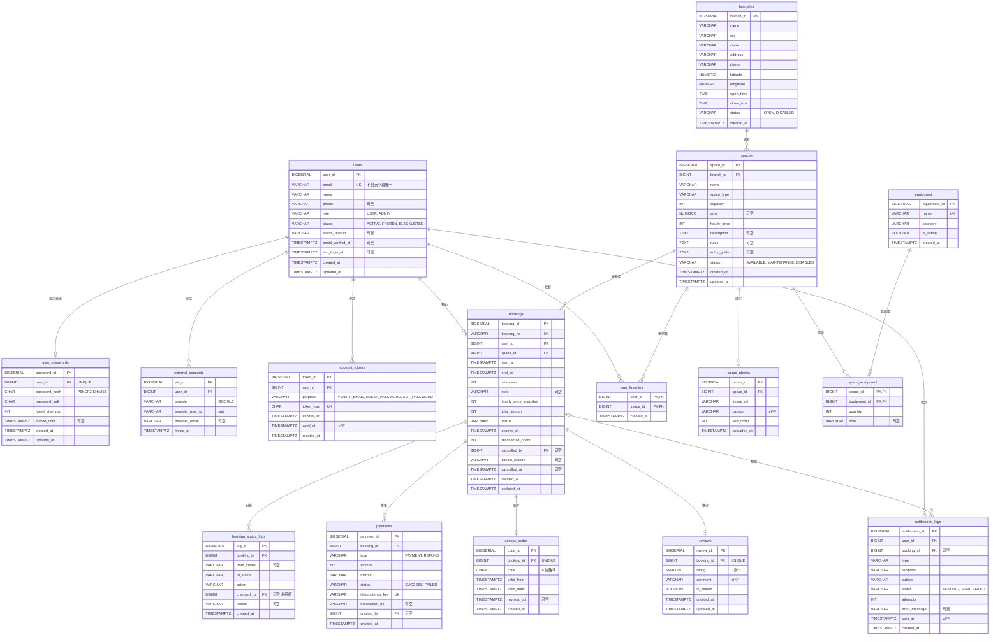

# SCHEMA：正式資料結構

> 系統：聚點 空間租借系統｜資料庫：PostgreSQL 16｜版本：實作前確認稿 v1（2026-10-28）
> 本檔是資料結構的唯一依據。Alembic migration 必須與本檔一致；參考 DDL 見 `docs/sql/schema.sql`（已在 PostgreSQL 16 實際執行並通過約束測試）。

## 1. 總覽

共 **16 張資料表、136 個欄位，平均每張 8.5 個欄位**（課程要求：至少 6 張、平均 6 個屬性）。

| # | 資料表 | 中文 | 用途 | 欄位數 |
|---|---|---|---|---|
| 1 | users | 使用者 | 基本資料、角色、帳號狀態、email 驗證 | 11 |
| 2 | user_passwords | 登入密碼 | 密碼雜湊、鹽值、登入失敗鎖定 | 8 |
| 3 | external_accounts | 外部帳號 | Google 身分綁定 | 6 |
| 4 | account_tokens | 帳號權杖 | email 驗證、重設密碼、設定密碼的單次權杖 | 7 |
| 5 | branches | 場館 | 地址、經緯度、電話、營業時間 | 12 |
| 6 | spaces | 空間 | 類型、容量、面積、時租、規定、進入方式 | 13 |
| 7 | space_photos | 空間照片 | 照片與排序 | 6 |
| 8 | equipment | 設備 | 設備種類 | 5 |
| 9 | space_equipment | 空間設備 | 空間與設備的多對多、數量與規格 | 4 |
| 10 | bookings | 訂單 | 預約時段、金額快照、狀態、付款期限 | 18 |
| 11 | booking_status_logs | 訂單狀態紀錄 | 每次狀態變動的時間、操作者、原因 | 8 |
| 12 | payments | 付款與退款 | 模擬付款、退款、冪等鍵 | 10 |
| 13 | access_codes | 房間密碼 | 訂單專屬密碼、有效期間、撤銷 | 7 |
| 14 | reviews | 評論 | 評分、留言、隱藏狀態 | 7 |
| 15 | user_favorites | 收藏 | 使用者收藏的空間 | 3 |
| 16 | notification_logs | 通知紀錄 | 寄信結果與重試 | 11 |

## 2. 共用約定

- **命名**：資料表與欄位使用 snake_case 複數表名；主鍵 `<單數>_id`，型別 BIGSERIAL。
- **時間**：所有時間點使用 `TIMESTAMPTZ`，資料庫存 UTC；營業時間 `TIME` 代表 Asia/Taipei 當地時間；畫面一律以 Asia/Taipei 顯示。
- **列舉**：以 `VARCHAR + CHECK` 實作（比 PostgreSQL ENUM 容易用 migration 增減值），程式中對應 Python `Enum`。
- **金額**：新台幣元，`INT`。
- **刪除**：場館、空間、訂單、使用者一律不實體刪除，以狀態欄位處理。可實體刪除的只有：照片、收藏、空間設備（使用者操作），以及過期的房間密碼與帳號權杖（排程清理）。
- **updated_at**：由 ORM 在更新時自動寫入。

## 3. ER 圖



> `booking_status_logs.changed_by`、`payments.created_by`、`bookings.cancelled_by` 也是指向 `users` 的外鍵；為讓圖面清楚，圖中省略這三條線。

## 4. 資料字典

未標「可空」的欄位皆為 NOT NULL。

### 4.1 users（使用者）

| 欄位 | 型別 | 約束 | 說明 |
|---|---|---|---|
| user_id | BIGSERIAL | PK | |
| email | VARCHAR(254) | UNIQUE（不分大小寫） | 登入帳號與通知信箱 |
| name | VARCHAR(50) | | 姓名 |
| phone | VARCHAR(20) | 可空 | 手機 |
| role | VARCHAR(10) | `USER`／`ADMIN`，預設 USER | 角色 |
| status | VARCHAR(12) | `ACTIVE`／`FROZEN`／`BLACKLISTED`，預設 ACTIVE | 帳號狀態 |
| status_reason | VARCHAR(200) | 可空；status 非 ACTIVE 時必填 | 凍結或黑名單原因 |
| email_verified_at | TIMESTAMPTZ | 可空 | email 驗證時間；NULL 代表未驗證 |
| last_login_at | TIMESTAMPTZ | 可空 | 最後登入，用於久未登入凍結 |
| created_at／updated_at | TIMESTAMPTZ | | |

### 4.2 user_passwords（登入密碼）

| 欄位 | 型別 | 約束 | 說明 |
|---|---|---|---|
| password_id | BIGSERIAL | PK | |
| user_id | BIGINT | FK → users，UNIQUE | 一人最多一組；只用 Google 登入者沒有此資料 |
| password_hash | CHAR(64) | | PBKDF2-SHA256（600,000 次）結果，hex |
| password_salt | CHAR(32) | | 16 bytes 隨機鹽值，hex；每次改密碼重新產生 |
| failed_attempts | INT | ≥ 0，預設 0 | 連續失敗次數，成功後歸零 |
| locked_until | TIMESTAMPTZ | 可空 | 連續失敗 5 次鎖定 15 分鐘 |
| created_at／updated_at | TIMESTAMPTZ | | |

### 4.3 external_accounts（外部帳號）

| 欄位 | 型別 | 約束 | 說明 |
|---|---|---|---|
| ext_id | BIGSERIAL | PK | |
| user_id | BIGINT | FK → users | |
| provider | VARCHAR(10) | `GOOGLE` | |
| provider_user_id | VARCHAR(255) | | Google 的 `sub` |
| provider_email | VARCHAR(254) | 可空 | 綁定當下的 Google email，僅供顯示 |
| linked_at | TIMESTAMPTZ | | |

額外約束：UNIQUE (provider, provider_user_id)；UNIQUE (user_id, provider)，一人每種外部帳號最多綁一個。

### 4.4 account_tokens（帳號權杖）

| 欄位 | 型別 | 約束 | 說明 |
|---|---|---|---|
| token_id | BIGSERIAL | PK | |
| user_id | BIGINT | FK → users | |
| purpose | VARCHAR(20) | `VERIFY_EMAIL`／`RESET_PASSWORD`／`SET_PASSWORD` | 用途 |
| token_hash | CHAR(64) | UNIQUE | SHA-256(token)；明文只出現在信件連結 |
| expires_at | TIMESTAMPTZ | > created_at | 驗證信 24 小時；重設與設定密碼 30 分鐘 |
| used_at | TIMESTAMPTZ | 可空 | 使用後即失效 |
| created_at | TIMESTAMPTZ | | |

### 4.5 branches（場館）

| 欄位 | 型別 | 約束 | 說明 |
|---|---|---|---|
| branch_id | BIGSERIAL | PK | |
| name | VARCHAR(50) | | |
| city／district | VARCHAR(20) | 索引 (city, district) | 地區搜尋 |
| address | VARCHAR(200) | | 前端組成 Google Maps 連結 |
| phone | VARCHAR(20) | | 支援電話（確認信、訂單頁顯示） |
| latitude／longitude | NUMERIC(9,6) | 範圍檢查 | 定位搜尋 |
| open_time／close_time | TIME | 整點；close_time > open_time | 每日營業時間（Asia/Taipei），不跨日 |
| status | VARCHAR(10) | `OPEN`／`DISABLED`，預設 OPEN | |
| created_at | TIMESTAMPTZ | | |

### 4.6 spaces（空間）

| 欄位 | 型別 | 約束 | 說明 |
|---|---|---|---|
| space_id | BIGSERIAL | PK | |
| branch_id | BIGINT | FK → branches | |
| name | VARCHAR(50) | UNIQUE (branch_id, name) | 例：201 會議室 |
| space_type | VARCHAR(10) | `MEETING`／`CLASSROOM`／`PARTY`／`STUDIO`／`MULTI` | 會議、教室、聚會、攝影、多功能 |
| capacity | INT | > 0 | 容納人數 |
| area | NUMERIC(5,1) | 可空，> 0 | 坪數 |
| hourly_price | INT | > 0 | 目前時租；下訂時快照到訂單 |
| description | TEXT | 可空 | 空間介紹 |
| rules | TEXT | 可空 | 使用規定 |
| entry_guide | TEXT | 可空 | 進入方式、設備操作與離場指引 |
| status | VARCHAR(12) | `AVAILABLE`／`MAINTENANCE`／`DISABLED`，預設 AVAILABLE | 只有 AVAILABLE 可被新預約與搜尋到 |
| created_at／updated_at | TIMESTAMPTZ | | |

### 4.7 space_photos（空間照片）

| 欄位 | 型別 | 約束 | 說明 |
|---|---|---|---|
| photo_id | BIGSERIAL | PK | |
| space_id | BIGINT | FK → spaces | |
| image_url | VARCHAR(255) | | 例：`/uploads/spaces/12/a1b2.webp` |
| caption | VARCHAR(100) | 可空 | |
| sort_order | INT | ≥ 0，預設 0 | 0 為封面 |
| uploaded_at | TIMESTAMPTZ | | |

### 4.8 equipment（設備）

| 欄位 | 型別 | 約束 | 說明 |
|---|---|---|---|
| equipment_id | BIGSERIAL | PK | |
| name | VARCHAR(50) | UNIQUE | 例：投影機、白板、飲水機 |
| category | VARCHAR(10) | `AV`／`FURNITURE`／`KITCHEN`／`NETWORK`／`OTHER` | 篩選分組 |
| is_active | BOOLEAN | 預設 TRUE | 停用後不出現在篩選與設定選單 |
| created_at | TIMESTAMPTZ | | |

### 4.9 space_equipment（空間設備）

| 欄位 | 型別 | 約束 | 說明 |
|---|---|---|---|
| space_id | BIGINT | PK、FK → spaces | |
| equipment_id | BIGINT | PK、FK → equipment | |
| quantity | INT | > 0，預設 1 | |
| note | VARCHAR(100) | 可空 | 規格，例：75 吋、HDMI |

### 4.10 bookings（訂單）

| 欄位 | 型別 | 約束 | 說明 |
|---|---|---|---|
| booking_id | BIGSERIAL | PK | |
| booking_no | VARCHAR(20) | UNIQUE | 對外訂單編號，例：`B20261108-0001` |
| user_id | BIGINT | FK → users | 預約人 |
| space_id | BIGINT | FK → spaces | |
| start_at／end_at | TIMESTAMPTZ | 整點；end_at > start_at | 半開區間 [start_at, end_at)，相鄰不算衝突 |
| attendees | INT | > 0 | 不可超過空間容量（service 檢查） |
| note | VARCHAR(500) | 可空 | 使用目的與備註 |
| hourly_price_snapshot | INT | > 0 | 下訂當下時租 |
| total_amount | INT | = 快照 × 時數 | 訂單金額；改期時重算 |
| status | VARCHAR(16) | `PENDING_PAYMENT`／`CONFIRMED`／`CANCELLED`／`EXPIRED`／`COMPLETED` | 見 PRD 狀態圖 |
| expires_at | TIMESTAMPTZ | | 付款期限 = 建立時間 + 15 分鐘 |
| reschedule_count | INT | 0 或 1 | 改期最多 1 次 |
| cancelled_by | BIGINT | 可空，FK → users | 取消者 |
| cancel_reason | VARCHAR(200) | 可空 | 管理員取消必填 |
| cancelled_at | TIMESTAMPTZ | 可空；status = CANCELLED 時必填，反之必為空 | |
| created_at／updated_at | TIMESTAMPTZ | | |

**核心約束 `ex_bookings_no_overlap`**：

```sql
EXCLUDE USING gist (space_id WITH =, tstzrange(start_at, end_at, '[)') WITH &&)
WHERE (status IN ('PENDING_PAYMENT','CONFIRMED'))
```

同一空間中，待付款與已確認的訂單時段不可重疊；取消、逾時、完成的訂單不佔用時段。由資料庫保證，併發時也不會重複預約（需 `btree_gist` 擴充）。

### 4.11 booking_status_logs（訂單狀態紀錄）

| 欄位 | 型別 | 約束 | 說明 |
|---|---|---|---|
| log_id | BIGSERIAL | PK | |
| booking_id | BIGINT | FK → bookings | |
| from_status | VARCHAR(16) | 可空 | 建立訂單時為 NULL |
| to_status | VARCHAR(16) | | |
| action | VARCHAR(12) | `CREATE`／`PAY`／`CANCEL`／`EXPIRE`／`COMPLETE`／`RESCHEDULE`／`REFUND` | 改期與部分退款狀態不變，仍要記錄 |
| changed_by | BIGINT | 可空，FK → users | NULL 代表系統排程 |
| reason | VARCHAR(200) | 可空 | |
| created_at | TIMESTAMPTZ | | |

### 4.12 payments（付款與退款）

| 欄位 | 型別 | 約束 | 說明 |
|---|---|---|---|
| payment_id | BIGSERIAL | PK | |
| booking_id | BIGINT | FK → bookings | |
| type | VARCHAR(8) | `PAYMENT`／`REFUND` | 退款另開一筆，不修改原付款 |
| amount | INT | > 0 | |
| method | VARCHAR(12) | `CREDIT_CARD`／`LINE_PAY` | 皆為模擬；退款沿用原付款方式 |
| status | VARCHAR(8) | `SUCCESS`／`FAILED` | 失敗原因固定為「卡片遭拒」（只有測試卡號會失敗），不另存欄位 |
| idempotency_key | VARCHAR(64) | UNIQUE | 付款與管理員部分退款：前端每次操作產生 UUID，以標頭傳入；取消與改期產生的退款：由後端產生（`refund-cancel-{booking_id}`、`refund-resched-{booking_id}`），確保同一訂單只退一次 |
| transaction_no | VARCHAR(40) | 可空；SUCCESS 時必填 | 模擬交易序號 |
| created_by | BIGINT | 可空，FK → users | 退款操作者 |
| created_at | TIMESTAMPTZ | | |

訂單實收 = 成功 PAYMENT 加總 − 成功 REFUND 加總；退款總額不可超過成功付款總額（service 檢查）。

### 4.13 access_codes（房間密碼）

| 欄位 | 型別 | 約束 | 說明 |
|---|---|---|---|
| code_id | BIGSERIAL | PK | |
| booking_id | BIGINT | FK → bookings，UNIQUE | 一張訂單一組 |
| code | CHAR(6) | 6 位數字 | 模擬門禁，以 `secrets` 產生 |
| valid_from | TIMESTAMPTZ | | start_at − 10 分鐘 |
| valid_until | TIMESTAMPTZ | > valid_from | end_at |
| revoked_at | TIMESTAMPTZ | 可空 | 取消時立即寫入 |
| created_at | TIMESTAMPTZ | | |

有效判斷：`revoked_at IS NULL AND now() BETWEEN valid_from AND valid_until`，查詢時即時計算，不依賴清理排程。清理排程只刪除 valid_until 超過 7 天的資料。

### 4.14 reviews（評論）

| 欄位 | 型別 | 約束 | 說明 |
|---|---|---|---|
| review_id | BIGSERIAL | PK | |
| booking_id | BIGINT | FK → bookings，UNIQUE | 一單一則；評論者與空間由訂單取得 |
| rating | SMALLINT | 1–5 | |
| comment | VARCHAR(500) | 可空 | |
| is_hidden | BOOLEAN | 預設 FALSE | 管理員隱藏 |
| created_at／updated_at | TIMESTAMPTZ | | |

### 4.15 user_favorites（收藏）

| 欄位 | 型別 | 約束 | 說明 |
|---|---|---|---|
| user_id | BIGINT | PK、FK → users | |
| space_id | BIGINT | PK、FK → spaces | |
| created_at | TIMESTAMPTZ | | 收藏時間，用於排序 |

### 4.16 notification_logs（通知紀錄）

| 欄位 | 型別 | 約束 | 說明 |
|---|---|---|---|
| notification_id | BIGSERIAL | PK | |
| user_id | BIGINT | FK → users | |
| booking_id | BIGINT | 可空，FK → bookings | |
| type | VARCHAR(20) | `VERIFY_EMAIL`／`RESET_PASSWORD`／`SET_PASSWORD`／`BOOKING_CONFIRMED`／`BOOKING_CANCELLED`／`BOOKING_RESCHEDULED` | |
| recipient | VARCHAR(254) | | |
| subject | VARCHAR(200) | | |
| status | VARCHAR(8) | `PENDING`／`SENT`／`FAILED`，預設 PENDING | |
| attempts | INT | ≥ 0 | 寄送次數 |
| error_message | VARCHAR(500) | 可空 | |
| sent_at | TIMESTAMPTZ | 可空 | |
| created_at | TIMESTAMPTZ | | |

信件內容含權杖連結，不存入本表；重寄驗證或重設信時重新產生權杖。

## 5. 對原草案（專案討論內容.md）的調整

| 調整 | 理由 |
|---|---|
| 資料庫改用 PostgreSQL；表名改 snake_case 複數 | 排除約束可在資料庫層防止重複預約；命名配合 SQLAlchemy 慣例 |
| Booking 的 `booking_date`＋`start_hour`／`end_hour` 改為 `start_at`／`end_at` | 排除約束需要時間區間；整點限制改由 CHECK 保證 |
| Booking 新增 booking_no、attendees、note、hourly_price_snapshot、expires_at、reschedule_count、cancel_reason、cancelled_at；狀態新增 EXPIRED | 對應 US-27、US-31、US-36、改期與取消規則 |
| PasswordResetToken 改為 account_tokens，加 purpose | email 驗證、重設密碼、設定密碼共用同一機制，不重複開表 |
| users 新增 email_verified_at、updated_at；狀態非 ACTIVE 時原因必填 | US-13 email 驗證；稽核需求 |
| user_passwords 保留 password_salt，型別改為固定長度 | 組內要求 hash 與 salt 分開存放 |
| external_accounts 新增 UNIQUE (user_id, provider) | 一人每種外部帳號只綁一個 |
| branches 新增 phone、created_at；status 改為 OPEN／DISABLED | US-45／US-47 支援電話 |
| spaces 新增 space_type、description、rules、updated_at；刪除 equipment_desc；status 的 DELETED 改為 DISABLED | US-05、US-56；設備改由設備表管理；停用即軟刪除 |
| space_photos 刪除 branch_id，space_id 改 NOT NULL | 場館可由空間查得，避免不一致 |
| equipment 名稱改 NOT NULL UNIQUE，新增 category、is_active、created_at | 避免重複設備；篩選分組 |
| space_equipment 新增 note | 原 equipment_desc 的規格說明移到這裡 |
| payments 新增 type、idempotency_key、created_by；status 的 REFUNDED 改由 type = REFUND 表示 | 防止重複付款；支援部分退款（US-62） |
| access_codes 新增 revoked_at；code 限 6 位數字 | 取消時立即失效 |
| reviews 新增 updated_at | |
| 新增 booking_status_logs、notification_logs | US-63 狀態紀錄；US-66 通知結果與重寄 |
| 收藏表命名為 user_favorites | |

## 6. 需由 service 層保證的規則

以下規則無法單靠資料庫約束，必須在 service 層實作並有對應測試：

1. 預約時段在場館營業時間內、同一天、在可預約範圍內（下一個整點到 60 天內）。
2. attendees ≤ 空間 capacity；空間 AVAILABLE、場館 OPEN；使用者 ACTIVE 且 email 已驗證。
3. 每人同時最多 3 筆待付款訂單。
4. 退款總額不超過成功付款總額。
5. 評論限本人、已完成、自 end_at 起 30 天內。
6. 每次訂單狀態變動都寫入 booking_status_logs（由 `Booking.transition()` 統一處理，見 ARCHITECTURE.md 第 3 節）。

### 已知取捨：`total_amount` 的 CHECK 約束（審查 C11）

`ck_bookings_amount` 要求 `total_amount = hourly_price_snapshot × 時數`，等於把 BR-07 的計價公式同時寫在資料庫與 `PricingPolicy` 兩處，形成資料庫與程式之間的隱性耦合。保留的理由：它是最後一道防線，能擋下程式錯誤造成的錯誤金額，且課程範圍內不會有折扣或優惠。**若日後加入優惠券或折扣，必須先移除或修改此約束，再改 `PricingPolicy`。**
