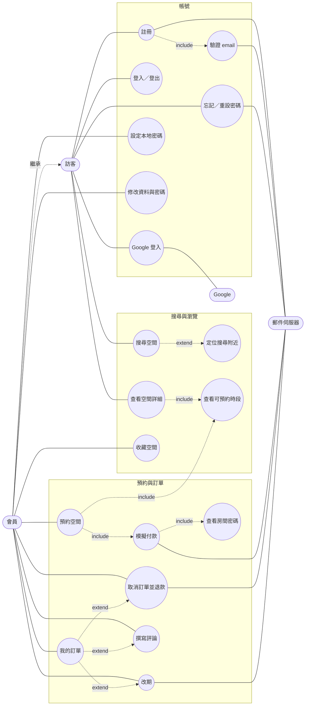
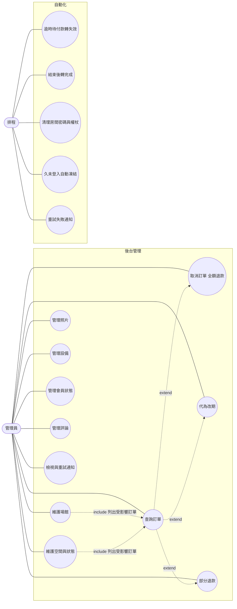
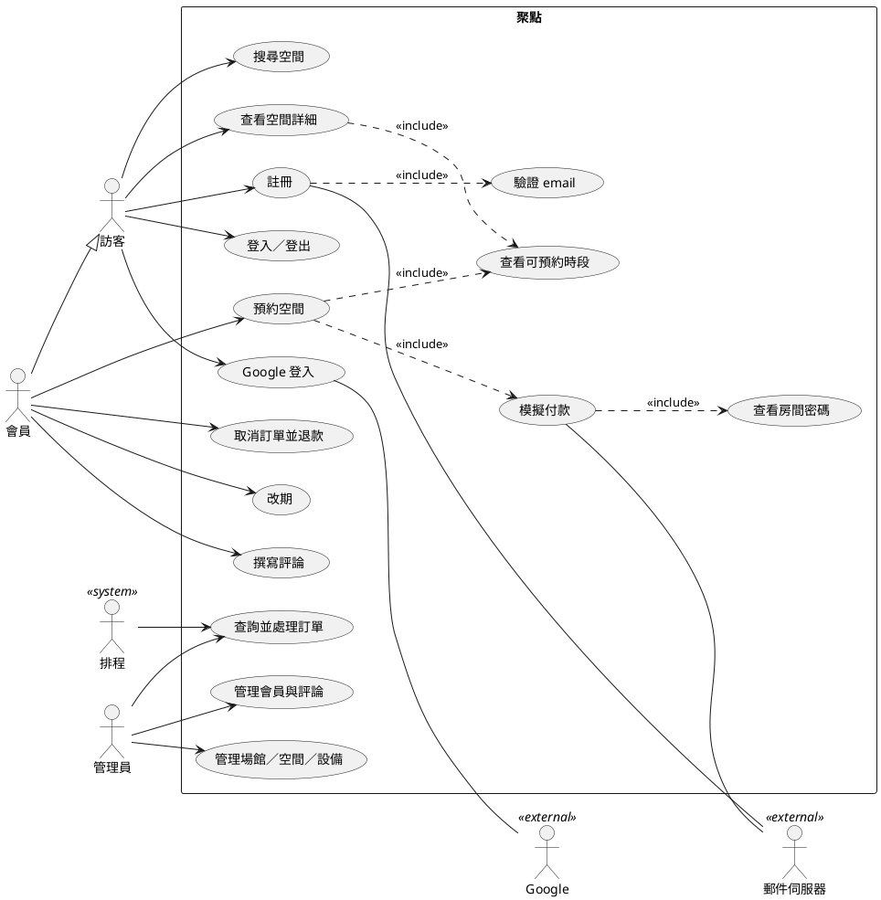

# 用例圖與程式追溯

> 系統：聚點 空間租借系統｜版本：初版實作（2026-10-28）
> 用途：補上設計圖文件中尚缺的 **Use Case 圖**（課程文件 (b) 需求分析），並建立「需求 → 程式 → 測試」的追溯表，方便撰寫 (c) 架構設計、(d) 物件設計時直接引用實際的類別與方法。
> 循序圖、類別圖、狀態圖、活動圖已在 `docs/設計圖_邏輯設計與細部設計.md`（D1～D13）；本次實作的類別、方法名稱與該文件一致，差異見第 4 節。

## 1. 使用者角色

| 角色 | 說明 |
|---|---|
| 訪客 | 未登入，可搜尋與瀏覽 |
| 會員 | 已登入的 USER；預約相關功能另需 email 已驗證且帳號 ACTIVE |
| 管理員 | ADMIN；由種子資料建立 |
| Google | 外部系統，身分驗證（開發期為 mock） |
| 郵件伺服器 | 外部系統，寄送驗證信與通知（開發期為 Mailpit） |
| 排程 | 時間觸發的系統角色（APScheduler） |

## 2. Use Case 圖

Mermaid 沒有原生 Use Case 圖，下列以 `flowchart` 表示：橢圓為用例，`<<include>>`／`<<extend>>` 以標註的虛線表示。若報告需要標準 UML 樣式，可將第 2.3 節的 PlantUML 貼到 plantuml.com 或 VS Code 外掛產生。

### 2.1 會員與訪客

### 2.2 管理員與排程

### 2.3 PlantUML（需要標準 UML 樣式時使用）

## 3. 需求追溯表（需求 → API → 程式 → 測試）

路徑皆相對於 `backend/`。測試欄為檔案，測試名稱內含 BR／FR 編號可直接搜尋。

| 需求 | API（`/api/v1`） | Controller | Service（方法） | Model／Policy | 測試 |
|---|---|---|---|---|---|
| FR-01 註冊 | POST `/auth/register` | `blueprints/auth.py` | `AuthService.register` | `User`、`UserPassword` | `tests/unit/test_accounts.py`、`tests/api/test_api.py` |
| FR-02 驗證 email | POST `/auth/verify-email`、`/auth/resend-verification` | `auth.py` | `AuthService.verify_email`／`resend_verification`、`PasswordService.consume_token` | `AccountToken` | `test_accounts.py` |
| FR-03 登入登出 | POST `/auth/login`、`/auth/logout`、GET `/auth/me` | `auth.py` | `AuthService.login`、`PasswordService.verify` | `UserPassword.is_locked` | `test_accounts.py`、`test_api.py` |
| FR-04 Google 登入 | GET `/auth/google/start`、`/callback`、POST `/auth/google/link` | `auth.py`、`dev.py` | `GoogleAuthService.handle_callback`／`link` | `ExternalAccount` | `test_accounts.py`、`test_api.py` |
| FR-05／06 重設與設定密碼 | POST `/auth/forgot-password`、`/reset-password`、`/set-password`、`/me/password/setup-email` | `auth.py`、`me.py` | `PasswordService.request_reset`／`reset`／`set_password`／`request_setup` | `AccountToken` | `test_accounts.py` |
| FR-07／08 資料與密碼 | PATCH `/me`、PUT `/me/password` | `me.py` | `AuthService.update_profile`、`PasswordService.change` | — | `test_accounts.py`、`test_api.py` |
| FR-10～12 搜尋 | GET `/spaces`、`/catalog/filters` | `catalog.py` | `CatalogService.search`／`filter_options` | `Space`、`Branch` | `tests/unit/test_catalog_admin.py` |
| FR-13 空間詳細 | GET `/spaces/{id}`、`/spaces/{id}/reviews` | `catalog.py` | `CatalogService.get_space`、`ReviewService.list_for_space` | — | `test_catalog_admin.py`、`test_api.py` |
| FR-14 可預約時段 | GET `/spaces/{id}/availability` | `catalog.py` | `AvailabilityService.availability`／`slots_for` | `Booking.occupying` | `test_booking_create.py` |
| FR-15 收藏 | PUT／DELETE／GET `/me/favorites` | `me.py` | `FavoriteService.add`／`remove`／`list` | `UserFavorite` | `test_catalog_admin.py`、`test_api.py` |
| FR-20 預約前確認 | POST `/bookings/quote` | `bookings.py` | `BookingService.quote` | `policies/pricing.amount` | `test_booking_create.py` |
| FR-21 建立訂單（BR-01～08） | POST `/bookings` | `bookings.py` | `BookingService.create`、`AvailabilityService.validate_slot` | `Booking`、`ex_bookings_no_overlap` | `test_booking_create.py`、`test_slot_validation.py`、`tests/concurrency/test_concurrency.py` |
| FR-22 付款（BR-09、10） | POST `/bookings/{id}/pay` | `bookings.py` | `BookingService.pay`、`PaymentService.charge`、`AccessCodeService.issue` | `Payment`、`AccessCode` | `test_booking_pay_cancel.py`、`test_concurrency.py` |
| FR-23 確認信 | （付款後寄送） | — | `NotificationService.enqueue`／`send_pending` | `mail/templates.py` | `test_booking_pay_cancel.py` |
| FR-30／31 訂單列表與詳細 | GET `/me/bookings`、`/bookings/{id}` | `me.py`、`bookings.py` | `BookingService.list_for_owner`／`get_for_owner` | `AccessCode.state` | `test_api.py` |
| FR-32 取消（BR-12、13） | GET `/bookings/{id}/cancel-quote`、POST `/cancel` | `bookings.py` | `BookingService.cancel_quote`／`cancel_by_member`／`_cancel` | `policies/refund.py` | `test_booking_pay_cancel.py`、`test_policies.py` |
| FR-33 改期（BR-14） | POST `/bookings/{id}/reschedule-quote`、`/reschedule` | `bookings.py` | `BookingService.reschedule_quote`／`reschedule_by_member`／`_reschedule` | `pricing.reschedule_diff` | `test_booking_reschedule_review.py` |
| FR-34 評論（BR-16） | POST `/bookings/{id}/review` | `bookings.py` | `ReviewService.create` | `Review` | `test_booking_reschedule_review.py` |
| FR-40～43 場館、空間、照片、設備 | `/admin/branches`、`/spaces`、`/photos`、`/equipment` | `admin.py` | `AdminCatalogService.*` | `Branch`、`Space`、`SpacePhoto`、`Equipment` | `test_catalog_admin.py`、`test_api.py` |
| FR-44 訂單查詢 | GET `/admin/bookings` | `admin.py` | `AdminBookingService.search`／`detail`／`summary` | — | `test_catalog_admin.py`、`test_api.py` |
| FR-45 訂單處理（BR-13、17、19） | POST `/admin/bookings/{id}/cancel`／`reschedule`／`refunds` | `admin.py` | `BookingService.cancel_by_admin`／`reschedule_by_admin`／`refund_partially` | — | `test_booking_pay_cancel.py`、`test_booking_reschedule_review.py` |
| FR-46 會員管理（BR-20） | GET `/admin/users`、PATCH `/admin/users/{id}/status` | `admin.py` | `AdminUserService.search`／`set_status` | `User` | `test_accounts.py` |
| FR-47 評論管理 | GET／PATCH `/admin/reviews` | `admin.py` | `ReviewService.list_all`／`set_hidden` | `Review` | `test_booking_reschedule_review.py` |
| FR-48 通知紀錄 | GET `/admin/notifications`、POST `/retry` | `admin.py` | `NotificationService.search`／`retry` | `NotificationLog` | `test_api.py` |
| FR-50～55 排程 | （無，`flask run-scheduler`） | `jobs/__init__.py`、`jobs/scheduler.py` | `BookingService.expire_overdue`／`complete_finished`、`AccessCodeService.purge_expired`、`PasswordService.purge_tokens`、`AdminUserService.freeze_inactive`、`NotificationService.retry_failed` | — | `test_booking_pay_cancel.py`、`test_accounts.py` |

前端（`frontend/src/`）對照：搜尋 `pages/SpacesPage.tsx`；空間詳細 `pages/SpaceDetailPage.tsx`（`components/SlotPicker.tsx`、`SlotGrid.tsx`，對應 D13）；預約 `BookPage.tsx`；付款 `PayPage.tsx`；訂單 `MyBookingsPage.tsx`、`BookingDetailPage.tsx`；後台 `pages/admin/*`。

## 4. 與設計圖 D3 的差異（供 (d) 物件設計文件使用）

實作時以下類別、方法與 D3 不完全相同，撰寫文件時請以**程式碼為準**，並視需要回頭更新設計圖。CLAUDE.md 規定改名或新增須先提出，這些項目請審查者確認。

| 項目 | 設計圖 D3 | 實作 | 原因 |
|---|---|---|---|
| `pay`、`reschedule_by_member` 的簽名 | `reschedule_by_member(user, id, new_slot, method, key)` | 多一個 `card_no`（`pay` 原本就有） | 改期補付也要能用測試卡號觸發卡片遭拒（D8） |
| `AvailabilityService` | `slots_for(space, local_date)` | 新增 `availability(space_id, local_date)` 回傳 DTO | Controller 只能拿到 id，且需帶出「暫停開放」「超出範圍」原因 |
| `BookingService` | 無 | 新增 `to_dto(booking)`、`list_affected(space_ids)` | 後台列出受停用影響的訂單（BR-18）；`AdminBookingService` 轉換 DTO。L3 已有 ADM → BKG 相依，未新增箭頭 |
| `AuthService` | 無 | 新增 `find_by_email`、`get`、`mark_login`、`update_profile` | 供 `GoogleAuthService`、Flask-Login 載入使用者與 FR-07 |
| `PasswordService` | 無 | 新增 `issue_token`、`send_token_mail`、`consume_token`、`request_setup`、`validate_strength` | 驗證信、重設、設定密碼共用同一組權杖機制（SCHEMA 的 `account_tokens`） |
| `AdminCatalogService` | `save_branch(data)` | `save_branch(branch_id, data)`（`None` 代表新增）；新增 `list_*`、`update_photo`、`delete_photo`、`create_equipment`、`update_equipment` | 涵蓋 FR-40～43 的列表與設備維護 |
| `NotificationService` | 無 | 新增 `search`、`count_failed` | FR-48 通知查詢與首頁數字 |
| `ReviewService` | 無 | 新增 `list_all` | 後台評論列表 |
| `Services` 容器 | 無 | `services/__init__.py` 的 `build_services()` | D3 說明的「create_app() 中組裝」 |

## 5. 與 PRD／SCHEMA／ARCHITECTURE 相比，實作時自行判斷的地方

這些是規格沒寫清楚、實作時依下列原則決定的地方，請審查者確認（同時是 PR 說明的素材）：

1. **營業時間上限為 23:00**：`close_time` 以 `TIME` 儲存，Python 無法表示 24:00，因此場館最晚營業到 23:00（跨午夜營業不支援，BR-01 本來就不跨日）。
2. **第 5 次登入失敗即回 `ACCOUNT_LOCKED`**，並在鎖定時把失敗次數歸零；鎖定期間輸入正確密碼也回 `ACCOUNT_LOCKED`。
3. **訪客看不到金額**：`POST /bookings/quote` 規格為會員專用，所以空間頁對訪客只顯示時數，登入後才顯示後端試算的金額。
4. **重設密碼信對「只用 Google 登入」的帳號改寄「設定密碼」信**（效果相同，也不洩漏帳號是否存在）。
5. **通知重試只處理訂單類通知**：驗證／重設／設定密碼信含單次權杖且不存內容，重寄需使用者重新申請，因此後台的重試鈕與排程都不重試這三類。
6. **管理員代為改期允許「待付款」與「已確認」訂單**；會員改期只限已確認。
7. **已結束但尚未被排程轉為 COMPLETED 的已確認訂單不可取消**（回 `INVALID_STATE`）。
8. **訂單編號** `B{yyyymmdd}-{booking_id 補零 4 位}`，id 取自資料表的 sequence，避免併發產生重複編號。
9. **評論者名稱遮罩**：公開顯示只保留第一個字（例：王○○）。
10. **資料庫選擇**：維持 PostgreSQL。「同一空間時段不可重疊」依賴 `EXCLUDE USING gist` 排除約束，MySQL 沒有等價機制，改用 MySQL 需要退回「先查再寫」或應用層鎖，違反 CLAUDE.md 架構規則 6，因此不採用。
