# 聚點 空間租借系統：邏輯設計與細部設計圖

> 版本 v2：2026-10-28｜依據：`docs/PRD.md`、`docs/SCHEMA.md`、`docs/ARCHITECTURE.md`
> v2 已套用《設計審查：耦合與內聚》的 C1～C13 修正，受影響的圖：L2、L3、D2-2、D3、D4、D5～D10、D12、D13。
> 所有圖以 Mermaid 撰寫，可直接貼進 HackMD 或放在 repo 的 `docs/` 中；修改規格時請同步修改對應的圖。

| 層次 | 圖 | 回答的問題 |
|---|---|---|
| 邏輯設計 | L1 系統情境圖 | 系統和誰互動？邊界在哪？ |
| | L2 邏輯分層架構 | 系統分幾層？每層負責什麼？ |
| | L3 模組相依圖 | 系統拆成哪些模組？誰依賴誰？ |
| | L4 邏輯資料模型 | 有哪些實體？彼此關係與多重性？ |
| | L5 部署圖 | 邏輯元件部署在哪些容器？ |
| 細部設計 | D1 類別圖：Model 層（帳號與互動） | 資料類別的屬性與方法 |
| | D2 類別圖：Model 層（場地、交易） | 同上 |
| | D3 類別圖：Service 與 Controller | 商業邏輯類別的介面與相依 |
| | D4 類別圖：例外與錯誤碼 | 錯誤如何分類並對應 HTTP 回應 |
| | D5 循序圖：建立訂單 | 物件間如何互動、交易邊界在哪 |
| | D6 循序圖：付款 | 冪等與逾時競爭如何處理 |
| | D7 循序圖：取消並退款 | |
| | D8 循序圖：改期 | |
| | D9 循序圖：Google 登入 | 三種情況的分支 |
| | D10 狀態圖：訂單、房間密碼、帳號 | 物件生命週期 |
| | D11 活動圖：可預約時段計算 | 演算法步驟 |
| | D12 活動圖：退款金額計算（RefundPolicy） | 規則判斷 |
| | D13 前端元件圖：空間詳細與預約 | View 層如何拆元件 |

---

# 一、邏輯設計（Logical Design）

邏輯設計描述系統「由哪些部分組成、各部分的職責與關係」，不涉及類別與方法的細節。

## L1 系統情境圖

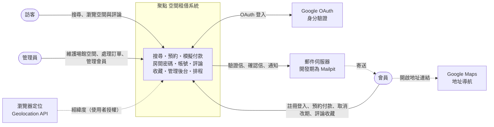

系統邊界外的 Google OAuth、郵件伺服器在開發期以 mock 與 Mailpit 替代；金流與實體門鎖不在範圍內，以模擬方式在系統內部處理。

## L2 邏輯分層架構

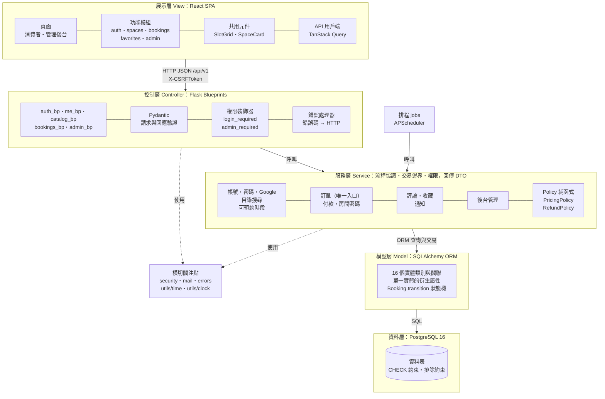

| 層 | 職責 | 不可以做的事 |
|---|---|---|
| View | 畫面、互動、前端輸入驗證、顯示時區轉換 | 權限判斷、金額與時段計算 |
| Controller | 解析請求、驗證格式、呼叫 Service、把錯誤碼轉成 HTTP 回應 | 寫商業規則、接觸 ORM 物件 |
| Service | 協調流程、交易邊界、權限與資料所有權；回傳 DTO | 處理 HTTP 細節、直接讀系統時間（改用注入的 Clock） |
| Policy（Service 層內） | 金額、價差、退款比例的純函式計算 | 存取資料庫 |
| Model | 資料表對應、關聯、衍生屬性；`Booking.transition()` 檢查並執行狀態轉換 | 跨表的商業流程 |
| 資料層 | 完整性約束、防止時段重疊 | — |

相依方向只能由上往下；排程與 Controller 一樣只能透過 Service 存取資料。

## L3 模組相依圖

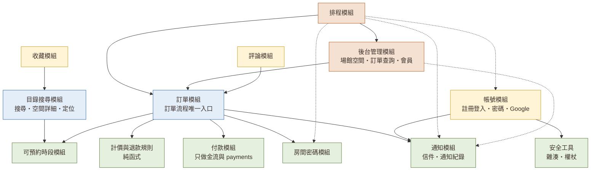

| 模組 | 主要 Service | 對應 FR | 依賴 |
|---|---|---|---|
| 帳號 | AuthService、PasswordService、GoogleAuthService | FR-01～08 | 安全工具、通知 |
| 目錄搜尋 | CatalogService | FR-10～14 | 可預約時段 |
| 可預約時段 | AvailabilityService | FR-14 | — |
| 訂單 | BookingService | FR-20～22、30～33、45 | 可預約時段、計價與退款規則、付款、房間密碼、通知 |
| 計價與退款規則 | PricingPolicy、RefundPolicy（純函式） | BR-07、12～14 | — |
| 付款 | PaymentService | FR-22（金流部分） | — |
| 房間密碼 | AccessCodeService | FR-23、31 | — |
| 評論 | ReviewService | FR-12（評論列表）、34、47 | 訂單 |
| 收藏 | FavoriteService | FR-15 | 目錄搜尋 |
| 通知 | NotificationService | FR-23、48 | — |
| 後台管理 | AdminCatalogService、AdminBookingService（只做查詢）、AdminUserService | FR-40～48 | 訂單、通知 |
| 排程 | jobs | FR-50～55 | 訂單、後台管理、帳號、房間密碼、通知 |

顏色代表層次：**橘色**為入口（呼叫者）、**黃色**為功能模組、**藍色**為核心交易、**綠色**為底層共用。箭頭只由上層指向下層，模組之間沒有循環相依；排程呼叫後台管理模組的「久未登入凍結」，兩者同屬入口層。虛線為跨越兩層的直接呼叫（排程清理房間密碼與權杖、重寄通知；後台重寄通知）。

v2 的變化：付款模組不再依賴任何模組（審查 C1）；後台管理不再直接呼叫付款與帳號（C2、C8）；新增「計價與退款規則」純函式模組（C5）。綠色的底層模組被依賴最多，應最先完成並有完整測試。

## L4 邏輯資料模型

只列實體、主鍵、外鍵與關係；完整欄位與型別見 `docs/SCHEMA.md`。

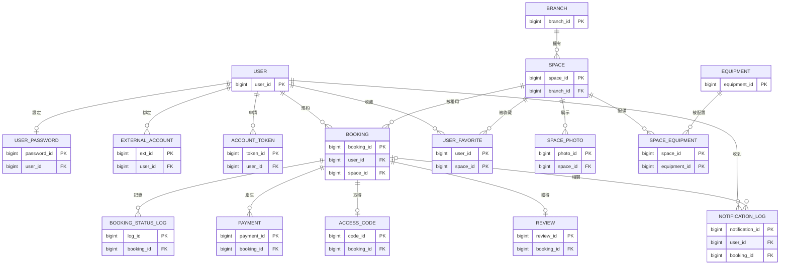

16 個實體分成四群：帳號（User、UserPassword、ExternalAccount、AccountToken）、場地（Branch、Space、SpacePhoto、Equipment、SpaceEquipment）、交易（Booking、BookingStatusLog、Payment、AccessCode）、互動與通知（Review、UserFavorite、NotificationLog）。Booking 是交易的核心，同時連結使用者與空間。

## L5 部署圖

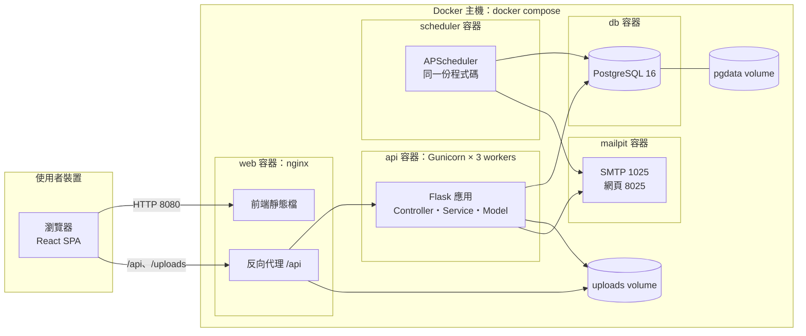

api 與 scheduler 使用同一個映像；排程獨立成一個容器，避免 Gunicorn 的多個 worker 重複執行排程工作。

---

# 二、細部設計（Detailed Design）

細部設計描述類別、方法、物件互動與演算法，程式實作應與這些圖一致。類別與方法名稱為設計規格，實作時如需調整，須同步更新本檔。

## D1 類別圖：Model 層（帳號與互動）

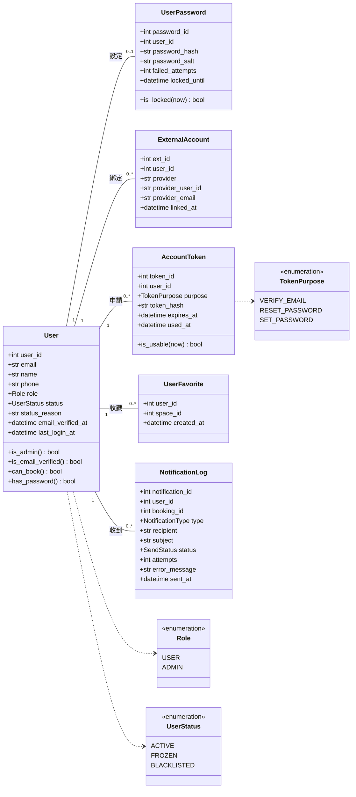

`User.can_book()` 回傳 `status == ACTIVE and email_verified_at is not None`（BR-05）；`has_password()` 用於判斷顯示「變更密碼」或「設定密碼」（FR-08）。Review 經由訂單連到使用者，畫在 D2。

## D2 類別圖：Model 層（場地與交易）

### D2-1 場地

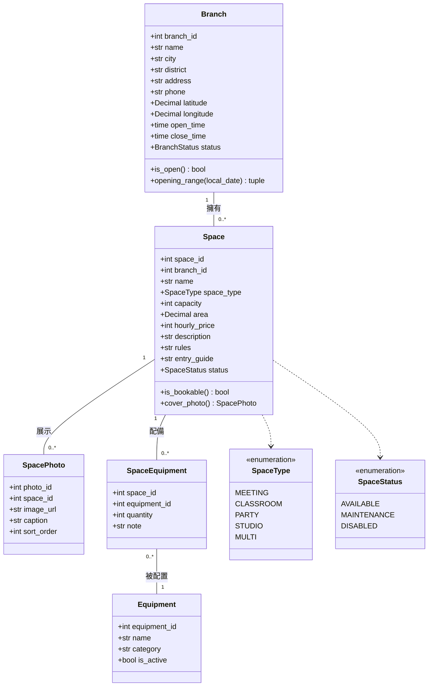

### D2-2 交易

User 與 Space 只列出交易會用到的成員，完整定義見 D1 與 D2-1。

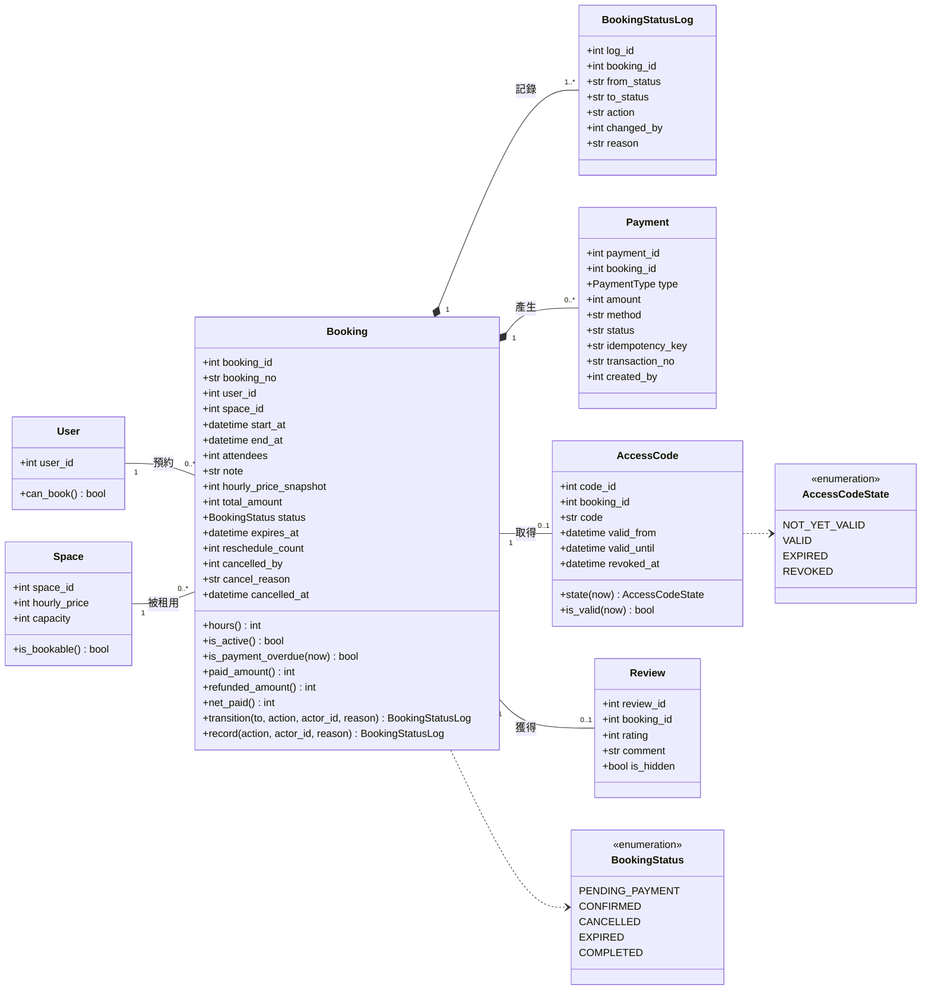

- `Booking.transition()`：**唯一可以改變訂單狀態的方法**。依 D10 狀態圖的允許清單（PENDING_PAYMENT → CONFIRMED／EXPIRED／CANCELLED；CONFIRMED → CANCELLED／COMPLETED）檢查，不合法時拋出 `ConflictError(INVALID_STATE)`，合法時更新狀態並產生狀態紀錄（審查 C4）。
- `Booking.record()`：不改變狀態、只寫狀態紀錄，用於改期（RESCHEDULE）與部分退款（REFUND）。
- `Booking.is_active()`：狀態為 PENDING_PAYMENT 或 CONFIRMED，與資料庫排除約束的條件相同。
- `Booking.net_paid()` = 成功 PAYMENT 加總 − 成功 REFUND 加總，退款計算一律以此為基準（BR-12、17）。
- `AccessCode.state(now)` 在查詢時即時計算：revoked_at 有值 → REVOKED；now < valid_from → NOT_YET_VALID；now > valid_until → EXPIRED；其餘 VALID（BR-11）。
- Model 只放單一實體可計算的衍生屬性；跨實體的規則一律在 Service 層。

## D3 類別圖：Service 與 Controller

### Controller（Blueprint）呼叫哪些 Service

| Blueprint | 路徑前綴 | 呼叫的 Service |
|---|---|---|
| auth_bp | `/api/v1/auth` | AuthService、PasswordService、GoogleAuthService |
| me_bp | `/api/v1/me` | AuthService、PasswordService、BookingService、FavoriteService |
| catalog_bp | `/api/v1/catalog`、`/api/v1/spaces` | CatalogService、AvailabilityService、ReviewService |
| bookings_bp | `/api/v1/bookings` | BookingService、AccessCodeService、ReviewService |
| admin_bp | `/api/v1/admin` | AdminCatalogService、AdminBookingService、AdminUserService、BookingService、ReviewService、NotificationService |
| dev_bp（僅開發模式） | `/api/v1/dev` | AuthService |

Blueprint 只依賴 Service，彼此之間沒有相依；`/bookings/{id}/pay` 呼叫 `BookingService.pay()`，Controller 不直接呼叫 PaymentService。Service 之間的相依如下圖。

### Service 類別與相依

```mermaid
classDiagram
    direction TB
    class jobs {
        <<Scheduler>>
        +expire_pending_bookings()
        +complete_finished_bookings()
        +purge_access_codes()
        +purge_account_tokens()
        +freeze_inactive_users()
        +retry_failed_notifications()
    }
    class AdminCatalogService {
        +save_branch(data) BranchDTO
        +set_branch_status(branch_id, status) list~BookingDTO~
        +save_space(data) SpaceDTO
        +set_space_status(space_id, status) list~BookingDTO~
        +upload_photo(space_id, file) PhotoDTO
        +reorder_photos(space_id, photo_ids) None
        +set_space_equipment(space_id, items) None
    }
    class AdminBookingService {
        +search(filters, page) Page~BookingDTO~
        +detail(booking_id) AdminBookingDetail
    }
    class AdminUserService {
        +search(filters, page) Page~UserDTO~
        +set_status(admin, user_id, status, reason) UserDTO
        +freeze_inactive() int
    }
    class ReviewService {
        +create(user, booking_id, rating, comment) ReviewDTO
        +list_for_space(space_id, page) Page~ReviewDTO~
        +set_hidden(review_id, hidden) ReviewDTO
    }
    class FavoriteService {
        +add(user, space_id) None
        +remove(user, space_id) None
        +list(user) list~SpaceSummary~
    }
    class GoogleAuthService {
        +handle_callback(google_identity) GoogleLoginResult
        +link(pending_identity, email, password) UserDTO
    }
    class AuthService {
        +register(email, name, password) UserDTO
        +create_from_google(email, name, verified) UserDTO
        +verify_email(token) None
        +resend_verification(email) None
        +login(email, password) UserDTO
    }
    class PasswordService {
        +set_initial(user_id, password) None
        +verify(user_id, password) bool
        +change(user, old, new) None
        +request_reset(email) None
        +reset(token, new_password) None
        +set_password(token, new_password) None
        +purge_tokens() int
    }
    class CatalogService {
        +search(filters, page) Page~SpaceSummary~
        +get_space(space_id) SpaceDetail
        +filter_options() FilterOptions
    }
    class BookingService {
        +quote(user, req) QuoteDTO
        +create(user, req) BookingDTO
        +pay(user, booking_id, method, card_no, key) PayResultDTO
        +get_for_owner(user, booking_id) BookingDTO
        +list_for_owner(user, tab, page) Page~BookingDTO~
        +cancel_quote(user, booking_id) RefundQuoteDTO
        +cancel_by_member(user, booking_id) BookingDTO
        +cancel_by_admin(admin, booking_id, reason) BookingDTO
        +reschedule_quote(user, booking_id, new_slot) RescheduleQuoteDTO
        +reschedule_by_member(user, booking_id, new_slot, method, key) BookingDTO
        +reschedule_by_admin(admin, booking_id, new_slot, reason) BookingDTO
        +refund_partially(admin, booking_id, amount, key) PaymentDTO
        +expire_overdue() int
        +complete_finished() int
        -_cancel(booking, ratio, actor, reason) None
        -_reschedule(booking, new_slot, actor, reason) int
    }
    class PricingPolicy {
        <<pure>>
        +amount(hourly_price, hours) int
        +reschedule_diff(snapshot, old_hours, new_hours) int
    }
    class RefundPolicy {
        <<pure>>
        +member_ratio(start_at, now) Decimal
        +admin_ratio() Decimal
        +refund_amount(net_paid, ratio) int
    }
    class AvailabilityService {
        +slots_for(space, local_date) list~Slot~
        +validate_slot(space, start_at, end_at) None
    }
    class PaymentService {
        +charge(booking_id, amount, method, card_no, key, actor_id) ChargeResult
        +refund(booking_id, amount, key, actor_id) Payment
        +find_by_key(key) Payment
        -simulate_gateway(method, card_no) bool
    }
    class AccessCodeService {
        +issue(booking) None
        +sync_validity(booking) None
        +revoke(booking) None
        +view_for_owner(user, booking_id) AccessCodeView
        +purge_expired() int
    }
    class NotificationService {
        +enqueue(user, type, booking, context) None
        +send_pending(ids) None
        +retry(notification_id) NotificationDTO
        +retry_failed() int
    }
    class Clock {
        <<interface>>
        +now() datetime
    }

    jobs ..> BookingService
    jobs ..> AdminUserService
    jobs ..> PasswordService
    jobs ..> AccessCodeService
    jobs ..> NotificationService
    AdminCatalogService --> BookingService
    ReviewService --> BookingService
    FavoriteService --> CatalogService
    GoogleAuthService --> AuthService
    GoogleAuthService --> PasswordService
    AuthService --> PasswordService
    AuthService --> NotificationService
    PasswordService --> NotificationService
    CatalogService --> AvailabilityService
    BookingService --> AvailabilityService
    BookingService ..> PricingPolicy
    BookingService ..> RefundPolicy
    BookingService --> PaymentService
    BookingService --> AccessCodeService
    BookingService --> NotificationService
```

**設計重點**

- **BookingService 是訂單流程的唯一入口**（審查 C1、C2）：建立、付款、取消、改期、部分退款、逾時與完成都由它協調。只有它能寫入 bookings、booking_status_logs 與退款，狀態一律透過 `Booking.transition()` 改變、紀錄一律透過 `Booking.record()` 寫入（C4）。
- **PaymentService 不依賴任何 Service**：只負責模擬金流與寫入 payments。`charge()`、`refund()` 不開交易，由 BookingService 的交易包住，確保「訂單變更＋金流紀錄」一起成功或一起失敗。
- **不用布林旗標**（C3）：會員與管理員規則不同的操作拆成 `*_by_member`、`*_by_admin` 兩個公開方法，規則差異寫在各自的方法裡，共用私有 `_cancel()`、`_reschedule()`。
- **計算規則抽成純函式**（C5）：`PricingPolicy`、`RefundPolicy` 不碰資料庫；`quote`、`cancel_quote`、`reschedule_quote` 與正式流程呼叫同一個函式，試算與實際結果不會不同。
- **帳號模組依職責拆成三個**（C7）：`AuthService`（註冊、驗證信、登入）、`PasswordService`（雜湊、變更、重設、失敗鎖定、清理權杖）、`GoogleAuthService`（回呼、綁定）。
- **評論的查詢與寫入都在 ReviewService**（C6）；`ReviewService` 透過 `BookingService.get_for_owner()` 確認訂單屬於本人且已完成，`FavoriteService.list()` 透過 `CatalogService` 組出空間摘要，兩者都不直接查其他模組的資料表。
- **排程只呼叫 Service**（C8）：每個工作只呼叫一個 Service 方法，例如久未登入凍結呼叫 `AdminUserService.freeze_inactive()`，`jobs` 本身不寫商業邏輯。
- **回傳 DTO**（C9）：Service 回傳 `schemas/` 中的 Pydantic 模型（圖中 `…DTO`），ORM 物件不離開 Service 層。
- **注入 Clock**（C13）：所有 Service 以建構子注入 `Clock`，不直接讀系統時間；測試時替換成固定時間。Service 之間同樣以建構子注入（`create_app()` 中組裝），測試時可替換 `PaymentService.simulate_gateway` 與郵件寄送。圖中省略各 Service 對 Clock 的相依線。
- `NotificationService.enqueue()` 在交易內寫入 PENDING 紀錄；`send_pending()` 在交易提交後才寄信。
- 實線箭頭為 Service 之間的相依；虛線為排程的呼叫與對純函式的使用。

## D4 類別圖：例外與錯誤碼

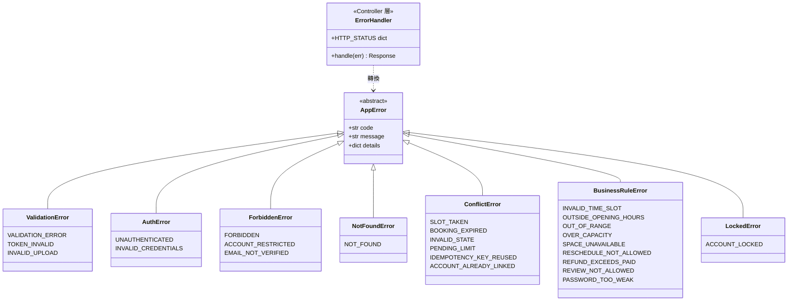

| 例外類別 | HTTP 狀態碼（對照表位於 `errors.py`，由 ErrorHandler 使用） |
|---|---|
| ValidationError | 400 |
| AuthError | 401 |
| ForbiddenError | 403 |
| NotFoundError | 404 |
| ConflictError | 409 |
| BusinessRuleError | 422 |
| LockedError | 423 |

Service 只拋出帶錯誤碼的 `AppError` 子類別，不知道 HTTP（審查 C10）；Controller 層的全域錯誤處理器依上表轉成統一格式 `{"error": {"code", "message", "details"}}`。資料庫排除約束的錯誤（`ExclusionViolation`）由 BookingService 攔截並轉為 `ConflictError(SLOT_TAKEN)`；不合法的狀態轉換由 `Booking.transition()` 拋出 `ConflictError(INVALID_STATE)`。限流的 429 由 Flask-Limiter 產生，不在此階層中。

## D5 循序圖：建立訂單（FR-21）

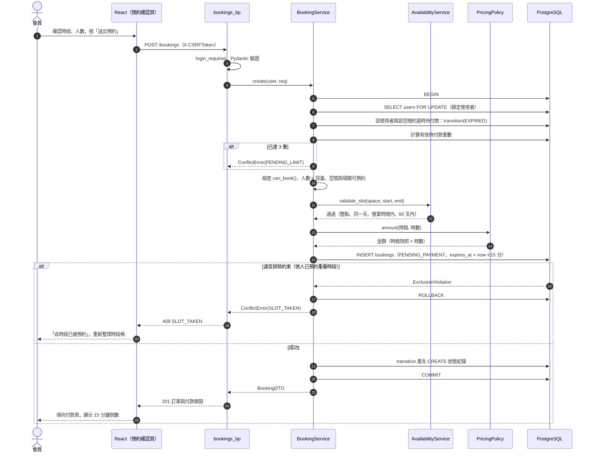

`now` 一律來自注入的 Clock；預約確認頁的金額來自 `quote()`，它與 `create()` 呼叫同一個 `PricingPolicy.amount()`。

## D6 循序圖：付款（FR-22）

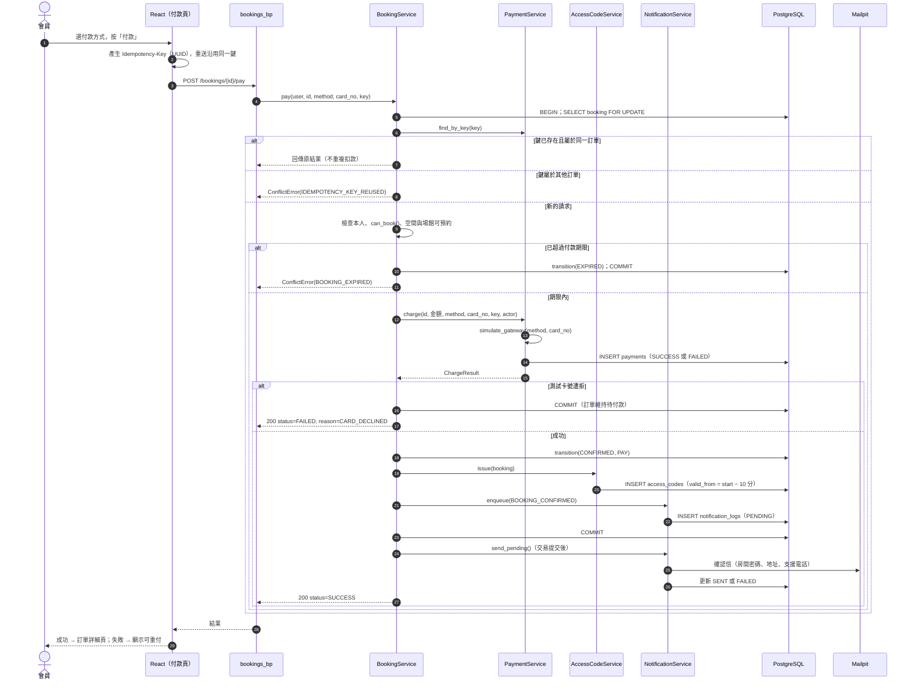

v2 的變化（審查 C1）：付款流程由 BookingService 協調；PaymentService 只負責金流與 payments 表，不再改訂單狀態、發房間密碼或寄信。訂單狀態不是 PENDING_PAYMENT 時，`transition()` 會拋出 `INVALID_STATE`。

逾時排程與付款同時處理同一筆訂單時，兩者都先鎖定訂單列；先取得鎖的一方生效，另一方讀到已變更的狀態而放棄，不會出現「已付款卻被標成逾時」。

## D7 循序圖：取消並退款（FR-32、FR-45）

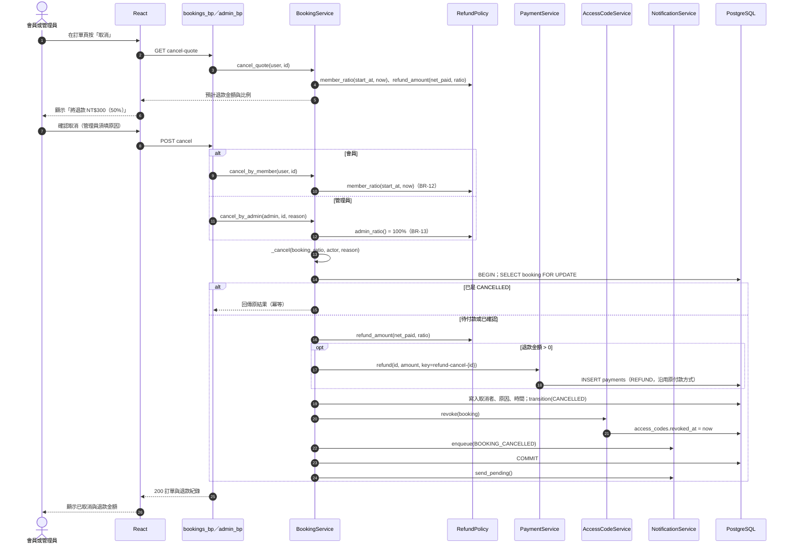

v2 的變化：會員與管理員改由兩個公開方法進入（審查 C3），只差在退款比例與原因是否必填；退款比例與金額由 `RefundPolicy` 計算（C5），試算與正式取消呼叫同一個函式。已完成或已失效的訂單由 `transition()` 拋出 `INVALID_STATE`。

## D8 循序圖：改期（FR-33、FR-45）

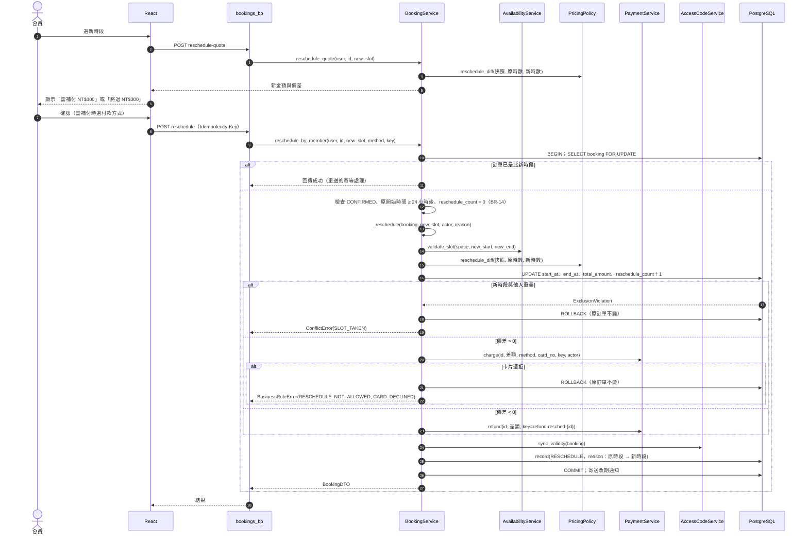

管理員代為改期呼叫 `reschedule_by_admin(admin, id, new_slot, reason)`：只檢查「時數與原訂單相同」（BR-19），不檢查 24 小時與次數、不增加 reschedule_count；因為時數相同，價差必為 0，沒有付款與退款分支。兩個方法共用私有 `_reschedule()`（審查 C3）。改期不改變訂單狀態，所以用 `record()` 而不是 `transition()`（C4）。

## D9 循序圖：Google 登入（FR-04）

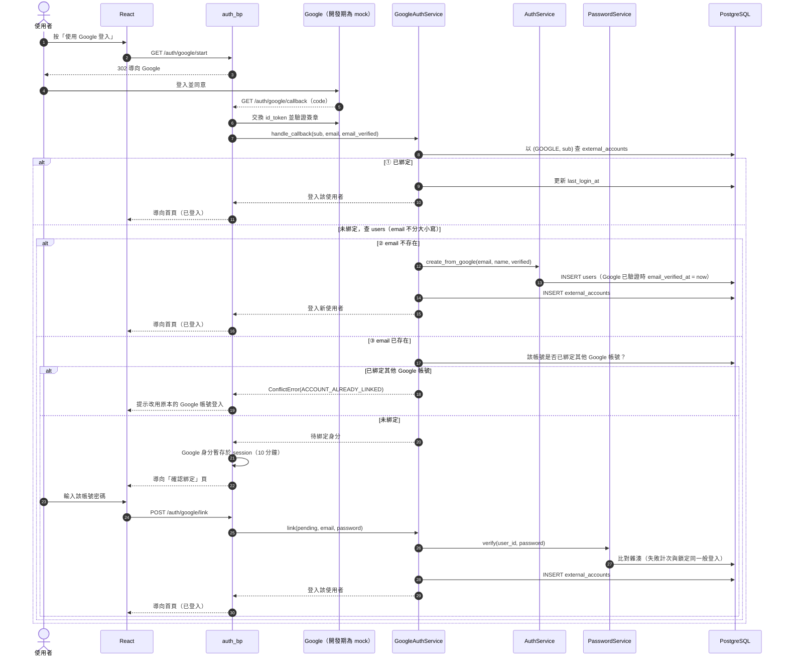

v2 的變化（審查 C7）：Google 登入獨立為 GoogleAuthService；建立使用者交給 AuthService，密碼驗證與失敗鎖定交給 PasswordService，三者各自只負責一件事。

## D10 狀態圖

### 訂單（Booking）

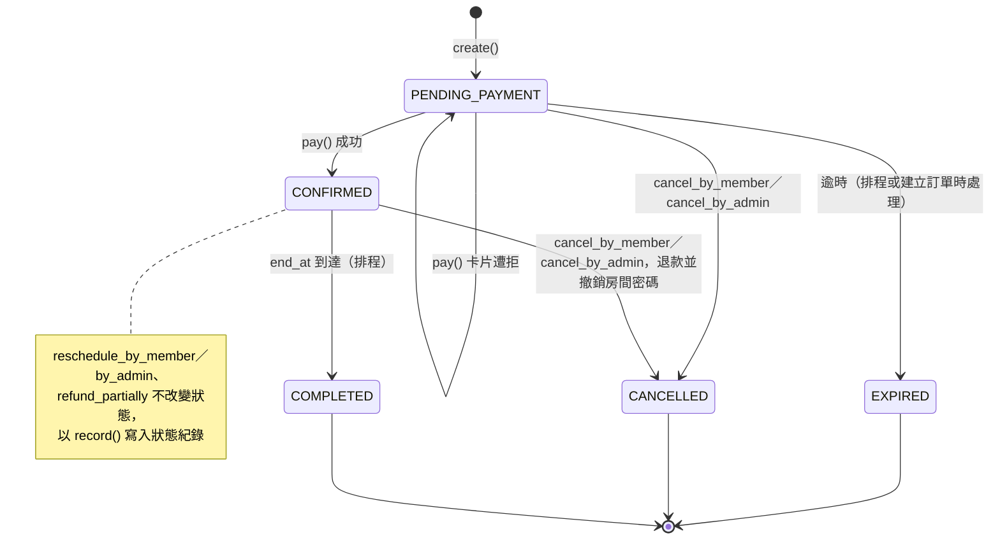

圖上的每一條轉換都由 `Booking.transition()` 執行（審查 C4）；圖上沒有的轉換（例如 COMPLETED → CANCELLED）一律拋出 `ConflictError(INVALID_STATE)`。佔用時段（受排除約束保護）的狀態只有 PENDING_PAYMENT 與 CONFIRMED。

### 房間密碼（AccessCode，查詢時即時計算）

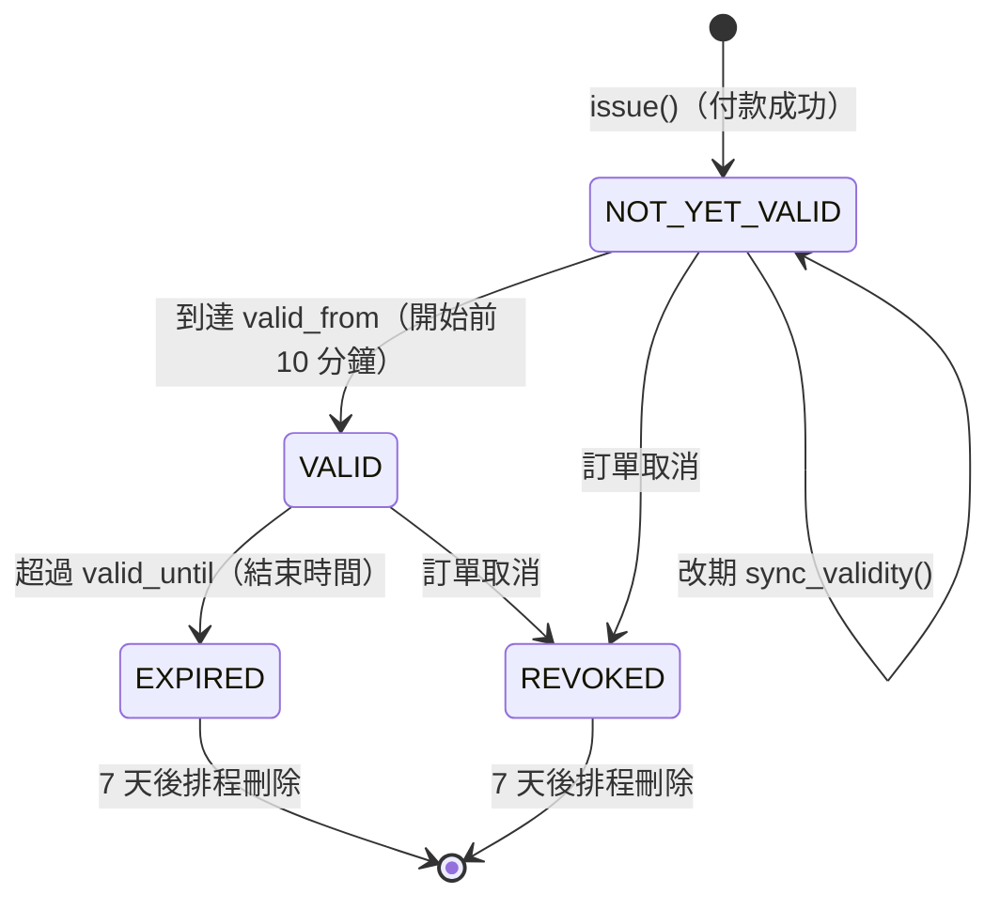

### 帳號（User）

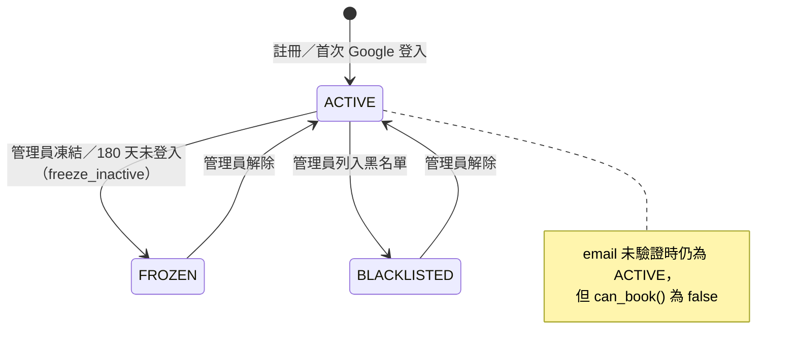

帳號狀態的變更都經過 `AdminUserService`（`set_status()`、`freeze_inactive()`）。

## D11 活動圖：可預約時段計算（AvailabilityService.slots_for）

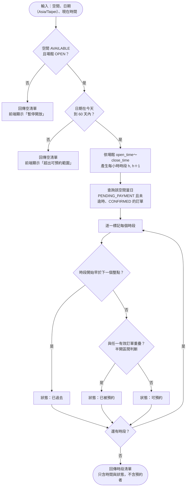

這個函式只用於顯示；真正防止重疊的是建立訂單時的資料庫排除約束。查詢時已排除逾時但尚未被排程處理的待付款訂單，所以畫面不會出現「看起來被訂走、其實已失效」的時段。

## D12 活動圖：取消退款金額計算（RefundPolicy）

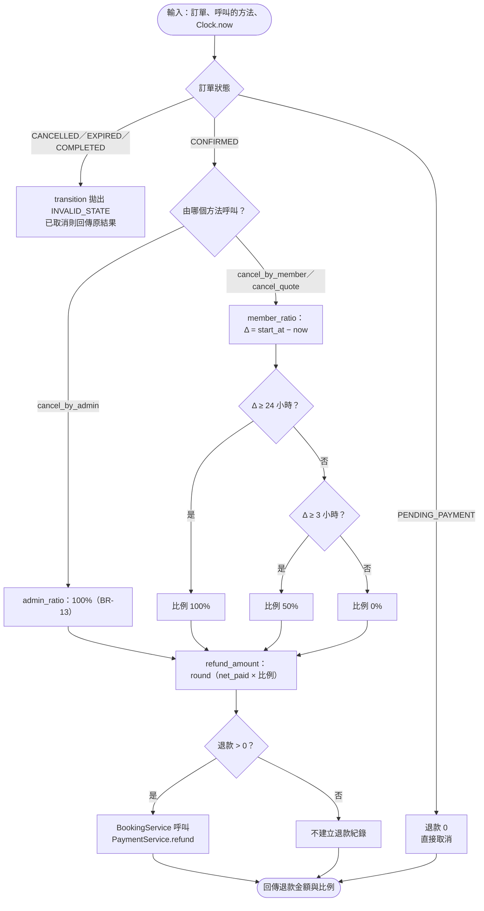

`member_ratio()`、`admin_ratio()`、`refund_amount()` 是 `RefundPolicy` 的純函式，不碰資料庫，可以直接對 24 小時、3 小時的邊界值寫單元測試（審查 C5）；狀態判斷由 `Booking.transition()` 負責，建立退款紀錄由 BookingService 負責。`net_paid` 已扣除先前的部分退款與改期退款，所以多次退款的總額不會超過實收（BR-17）。

## D13 前端元件圖：空間詳細與預約

```mermaid
flowchart LR
    Q1[(useSpace)]
    Q3[(useReviews)]
    M1[(useToggleFavorite)]
    Q2[(useAvailability<br/>依日期查詢)]
    Q4[(useQuote<br/>停止選取 300ms 後<br/>POST /bookings/quote)]

    Q1 --> G[PhotoGallery<br/>封面優先・可滑動]
    Q1 --> I[SpaceInfo<br/>類型・容量・面積・時租・規定]
    Q1 --> EQ[EquipmentList]
    Q1 --> BI[BranchInfo<br/>地址・電話・Google Maps]
    Q3 --> RV[ReviewList<br/>平均評分・分頁]
    M1 <-->|點擊切換| FV[FavoriteButton]
    Q2 --> SG[SlotGrid<br/>點選起訖・連續選取]
    DP[DatePicker<br/>今天～60 天] -->|選日期，觸發查詢| Q2
    SG -->|選取時段| Q4
    Q4 --> PS[PriceSummary<br/>顯示後端試算的時數與金額]
    PS --> BTN[預約按鈕]
    BTN -->|已登入| NAV[/導向 /book/:spaceId<br/>帶入日期與時段/]
    BTN -->|未登入| LOGIN[/導向 /login<br/>登入後返回本頁/]

    classDef hook fill:#E6F0DE,stroke:#5F7A45,color:#3B2F2A
    classDef booking fill:#F4E1D2,stroke:#B4632E,color:#3B2F2A
    class Q1,Q2,Q3,Q4,M1 hook
    class DP,SG,PS,BTN booking
```

- `SlotGrid` 只負責顯示與選取；`PriceSummary` 只顯示 `useQuote` 取得的後端試算結果，前端不自行計算金額（BR-07，審查 C12）。試算 API 與建立訂單使用同一個 `PricingPolicy`，所以預覽金額與實際金額一致。
- 綠色圓柱為資料 hook（TanStack Query），元件本身不直接呼叫 API；橘色為 BookingPanel 預約面板內的元件，其餘為空間資訊區元件，全部位於 `SpaceDetailPage`（`/spaces/:id`）。

