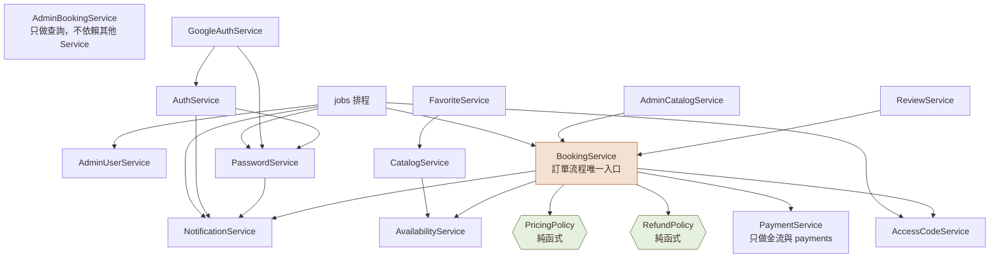

# 設計審查：耦合（Coupling）與內聚（Cohesion）

> 審查日期：2026-10-28｜審查範圍：`docs/ARCHITECTURE.md`、`docs/SCHEMA.md`、《設計圖：邏輯設計與細部設計》（L1～L5、D1～D13）
> 目的：在 11/01 開始寫程式前，找出耦合過高或內聚不足的設計，先修正規格，避免寫進程式後才重構。
>
> **狀態：C1～C13 已全部套用（2026-10-28）**。已更新 `ARCHITECTURE.md`（第 3、4、5.1、6、10 節）、`CLAUDE.md`（架構規則 7～12）、`SCHEMA.md`（C11 取捨說明）、`PRD.md`（第 8 節試算 API）與設計圖 v2（L2、L3、D2-2、D3、D4、D5～D10、D12、D13）。本文件保留「修正前」的描述作為審查紀錄。

## 1. 結論摘要

整體架構的分層、模組切分與資料庫約束設計良好，模組之間沒有循環相依。但 Service 層有 **13 個問題**，其中 **4 個建議在寫程式前修正**：

| 優先 | 編號 | 問題 | 類型 |
|---|---|---|---|
| 高 | C1 | 付款模組直接改訂單狀態、發房間密碼、寄信 | 內容耦合、低內聚 |
| 高 | C2 | 管理員部分退款繞過訂單模組，漏寫狀態紀錄 | 共用耦合 |
| 高 | C4 | 訂單狀態轉換分散在 5 個地方，各自寫狀態紀錄 | 低內聚 |
| 高 | C3 | `by_admin` 布林參數控制取消與改期的行為 | 控制耦合 |

這 4 項會改到 D3、D6 與 ARCHITECTURE.md 第 6 節。其餘 9 項為中、低優先。**組內決定 13 項全部在寫程式前套用到規格**，讓 Claude Code 從第一個 Story 起就照修正後的設計產生程式。

## 2. 評估基準

### 2.1 耦合（模組之間依賴的緊密程度，越低越好）

| 等級（由好到差） | 說明 | 本系統的例子 |
|---|---|---|
| 資料耦合 | 只傳必要的簡單參數 | `AvailabilityService.validate_slot(space, start_at, end_at, now)` |
| 戳記耦合 | 傳整個物件，只用其中幾個欄位 | 多數方法傳入整個 `user`，只用到 user_id 與狀態；可接受 |
| 控制耦合 | 傳旗標決定對方的執行邏輯 | `cancel(..., by_admin)`（C3） |
| 共用耦合 | 多個模組直接寫同一份資料 | 管理員退款直接寫 payments 而不經訂單模組（C2） |
| 內容耦合 | 一個模組直接修改另一個模組內部的資料 | 付款模組直接修改訂單狀態（C1） |

### 2.2 內聚（模組內部功能的相關程度，越高越好）

| 等級（由好到差） | 說明 | 本系統的例子 |
|---|---|---|
| 功能性內聚 | 所有成員共同完成單一功能 | `AccessCodeService`、`AvailabilityService` |
| 順序性內聚 | 前一步的輸出是下一步的輸入 | 建立訂單的流程 |
| 通訊性內聚 | 操作同一份資料，但功能不同 | `BookingService` 同時做查詢、指令、計價（C5） |
| 時間性內聚 | 只因為同一時間執行而放在一起 | `jobs` 排程模組（可接受，見 C8） |
| 邏輯性內聚 | 只因為「同類」而放在一起 | `AuthService` 混合登入、密碼、Google（C7） |

## 3. 做得好的地方（保留）

| 設計 | 對耦合或內聚的好處 |
|---|---|
| 分層架構，相依只能往下（L2） | 前端不知道資料庫，Controller 不寫商業規則，替換任一層的影響範圍小 |
| 模組相依圖沒有循環（L3） | 底層模組可以獨立開發與測試 |
| Controller 只做格式驗證與呼叫 Service | Controller 與商業規則解耦，同一個 Service 可同時被 API 與排程呼叫 |
| 防止重複預約交給資料庫排除約束 | 併發正確性不依賴任何 Service 的實作細節 |
| 通知先寫入 notification_logs，交易提交後才寄送，失敗由排程重試 | 寄信與交易解耦：郵件伺服器故障不會讓訂單失敗（類似 Outbox 模式） |
| `AccessCodeService`、`AvailabilityService` 職責單一 | 功能性內聚，容易寫單元測試 |
| 前端資料一律透過 TanStack Query hook 取得（D13） | 元件與 API 細節解耦，元件可用假資料測試 |
| 規格集中在 PRD、SCHEMA、ARCHITECTURE 三份文件 | 文件之間沒有重複內容，修改時只改一處 |

## 4. 問題與建議修正

### 高優先（寫程式前修正）

**C1　付款模組做了訂單模組的事**

- **現況**：`PaymentService.pay()` 除了記錄付款，還把訂單改為 CONFIRMED、呼叫 `AccessCodeService.issue()`、呼叫 `NotificationService.enqueue()`。
- **問題**：付款模組直接修改訂單狀態（內容耦合）；付款模組必須知道房間密碼與通知（低內聚）。之後若「付款成功」要多做一件事，就得改付款模組。
- **修正**：
  - 改由 `BookingService.pay()` 負責整個流程：鎖定訂單 → 呼叫 `PaymentService.charge()` → 依結果改狀態、發密碼、建立通知。
  - `PaymentService` 只負責「模擬金流＋寫 payments 表」，不依賴任何其他 Service。
  - bookings_bp 的 `/pay` 改呼叫 `BookingService.pay()`。

**C2　管理員部分退款繞過訂單模組**

- **現況**：`AdminBookingService.partial_refund()` 直接呼叫 `PaymentService.refund()`。
- **問題**：違反 BR-25（退款要寫狀態紀錄），而狀態紀錄屬於訂單模組；「退款總額不超過實收」的檢查會在兩個地方重複（共用耦合）。
- **修正**：新增 `BookingService.refund_partially(admin, booking_id, amount, key)`，所有寫入 bookings、booking_status_logs 與退款的動作都只經過 BookingService；`AdminBookingService` 只保留查詢（search、detail）。

**C3　用布林旗標控制行為**

- **現況**：`cancel(actor, booking_id, reason, by_admin)`、`reschedule(..., by_admin)`，方法內部用 `if by_admin` 切換兩套規則。
- **問題**：呼叫端控制被呼叫端的內部邏輯（控制耦合）；方法內的分支多，難以閱讀與測試。
- **修正**：改成語意明確的公開方法，共用私有核心：
  - `cancel_by_member(user, booking_id)`、`cancel_by_admin(admin, booking_id, reason)` → 共用 `_cancel(booking, refund_ratio, actor, reason)`。
  - `reschedule_by_member(...)`、`reschedule_by_admin(...)` → 共用 `_reschedule(...)`。
  - 規則差異（退款比例、24 小時限制、時數相同）放在各自的公開方法裡，一眼就看得出來。

**C4　訂單狀態轉換分散各處**

- **現況**：建立、付款、取消、逾時排程、完成排程各自設定 `booking.status` 並呼叫 `log_status()`。
- **問題**：D10 狀態圖的規則（例如 COMPLETED 不能再取消）沒有單一的實作位置，每個地方都可能漏檢查或漏寫紀錄（低內聚）。
- **修正**：在 Booking model 加上唯一的狀態轉換方法：

```python
ALLOWED = {
    ("PENDING_PAYMENT", "CONFIRMED"), ("PENDING_PAYMENT", "EXPIRED"),
    ("PENDING_PAYMENT", "CANCELLED"), ("CONFIRMED", "CANCELLED"),
    ("CONFIRMED", "COMPLETED"),
}

def transition(self, to, action, actor_id, reason=None) -> BookingStatusLog:
    """唯一可以改變訂單狀態的地方；不合法的轉換拋出 ConflictError(INVALID_STATE)，並回傳要寫入的狀態紀錄。"""
```

改期與部分退款不改變狀態，改用 `booking.record(action, actor_id, reason)` 寫紀錄。所有 Service 與排程都只能透過這兩個方法改狀態或寫紀錄，狀態機的單元測試也只要測這一個地方。

### 中優先（實作對應 Story 時處理）

| 編號 | 現況 | 問題 | 修正 |
|---|---|---|---|
| C5 | `BookingService` 內部直接計算金額、價差、退款比例 | 計算規則與資料庫存取混在一起（通訊性內聚）；試算 API 與正式流程可能算出不同結果 | 抽出不碰資料庫的純函式：`PricingPolicy`（金額、改期價差，BR-07、14）、`RefundPolicy`（退款比例與金額，BR-12、13）。試算與正式流程都呼叫同一個函式，可以不連資料庫直接寫單元測試 |
| C7 | `AuthService` 有 10 個方法，混合註冊登入、密碼、Google | 邏輯性內聚，檔案會很大，多人審查不易 | 拆成三個：`AuthService`（註冊、驗證信、登入登出）、`PasswordService`（雜湊、變更、重設、設定密碼、失敗鎖定）、`GoogleAuthService`（回呼、綁定） |
| C9 | Service 直接回傳 ORM 物件給 Controller | Controller 與 ORM 耦合；session 關閉後讀取關聯會出錯 | Service 回傳 `schemas/` 中的 Pydantic 回應模型，ORM 物件不離開 Service 層 |
| C13 | 有些方法傳入 `now`，有些直接讀系統時間 | 對系統時鐘的隱藏依賴，測試難以固定時間 | 建立 `Clock` 介面注入所有 Service，測試時替換成固定時間 |

### 低優先（有空再改，或在文件中記錄取捨即可）

| 編號 | 現況 | 問題 | 修正 |
|---|---|---|---|
| C6 | 評論的查詢在 `CatalogService.list_reviews()`，新增與隱藏在 `ReviewService` | 同一個功能分散在兩個模組 | 把 `list_reviews` 移到 `ReviewService` |
| C8 | 排程的「久未登入凍結」依賴 `AuthService` | 放錯模組；`jobs` 本身是時間性內聚 | 改呼叫 `AdminUserService.freeze_inactive()`。`jobs` 每個工作只呼叫一個 Service 方法、不寫邏輯，時間性內聚可以接受 |
| C10 | `AppError` 內含 `http_status` | Service 層知道 HTTP | `AppError` 只帶錯誤碼；錯誤碼與 HTTP 狀態碼的對照放在 Controller 層的錯誤處理器 |
| C11 | 資料庫 CHECK：`total_amount = 時租快照 × 時數` | 資料結構與目前的計價規則綁在一起；之後若做平假日定價就要改 migration | 保留（現在能保護資料正確性），在 (c) 文件記錄為已知取捨 |
| C12 | 前端 `PriceSummary` 自己算預估金額 | 計價規則在前後端各寫一次 | 改呼叫 `POST /bookings/quote`（輸入停止 300 毫秒後再送出），只顯示後端結果 |

## 5. 修正後的 Service 相依



| 指標 | 修正前 | 修正後 |
|---|---|---|
| PaymentService 依賴的 Service 數 | 2（房間密碼、通知） | 0 |
| 能寫入訂單、狀態紀錄、退款的 Service | 3（Booking、Payment、AdminBooking） | 1（Booking） |
| 有布林旗標控制行為的公開方法 | 2 | 0 |
| 修改訂單狀態的位置 | 5 處 | 1 處（`Booking.transition`） |
| 不需資料庫即可單元測試的業務規則 | 少數 | 金額、價差、退款比例、狀態轉換全部可以 |

BookingService 成為訂單流程的唯一入口，被依賴的次數增加；但它只負責協調流程，計算規則已移到兩個純函式、狀態規則移到 Booking model，所以內聚性反而比修正前高。

## 6. 各項產出對應的課程文件

### 6.1 對照表

| 產出 | (a) 專案管理 | (b) 需求分析 | (c) 架構設計 | (d) 物件設計 | (e) 測試計畫 | (f) 測試個案與報告 | (g) AI 使用 |
|---|---|---|---|---|---|---|---|
| 專案討論內容.md、User Story.md（組內原始資料） | | ● 需求來源 | | | | | ● AI 協助前的起點 |
| 實作前需求釐清（第一輪，已決議） | ● 決策紀錄、時程、分工 | ● 範圍決策、US 取捨 | | | | | ● AI 提出問題、人工決定 |
| 實作前確認稿.md | ● 時程、分工、里程碑 | ● 自行決定事項 | | | | | |
| `docs/PRD.md` | | ● **主體**：範圍、角色、BR、FR、NFR、頁面、流程、狀態圖 | | | ● 驗收條件即測試依據 | | |
| `docs/SCHEMA.md`、`sql/schema.sql` | | | ● **資料設計**：ER 圖、資料字典、約束 | ● D1、D2 的依據 | | | |
| `docs/ARCHITECTURE.md` | | | ● **主體**：技術選型、架構、API、交易與併發、安全 | ● 錯誤碼、交易流程 | ● 第 10 節測試策略 | | |
| L1 系統情境圖 | | ● 系統邊界 | ● 架構總覽 | | | | |
| L2 邏輯分層架構、L3 模組相依圖、L5 部署圖 | | | ● | | | | |
| L4 邏輯資料模型 | | ● 概念資料模型 | ● | | | | |
| D1～D4 類別圖 | | | | ● | | | |
| D5～D9 循序圖 | | | ○ 關鍵流程 | ● | ● 併發與錯誤情境 | | |
| D10 狀態圖 | | ○ 業務狀態 | | ● | ● 狀態轉換測試 | | |
| D11、D12 活動圖 | | | | ● 演算法 | ● 邊界值 | | |
| D13 前端元件圖 | | | ○ | ● | | | |
| 本設計審查（耦合與內聚） | | | ● 設計品質評估 | ● 修正後的類別設計 | | | ● 人工審查 AI 設計 |
| `docs/BMAD-開發指南.md` | ● 開發流程、角色、PR 與 Issue 規則 | | | | ● 測試負責人流程 | | ● BMAD 用法 |
| `CLAUDE.md` | ● 開發規範 | | ● 技術限制 | | | | ● AI 協作規則 |
| 資料庫約束與併發的實測結果（12 項約束、20 筆併發） | | | ● 設計驗證 | | | ● **第一批實際執行結果** | ● |
| `docs/ai-usage-log.md` | | | | | | | ● **主體** |
| BMAD 產出的 Epic、Story、Sprint 狀態（之後產生） | ● WBS、時程 | ● 需求追溯 | | | ● 測試範圍 | | ● |

●＝主要內容；○＝可引用

### 6.2 11/18 前還缺什麼

| 文件 | 已有 | 還缺（建議用 BMAD 開發指南第 8 節的 prompt 產生） | 負責 |
|---|---|---|---|
| (a) 專案管理規劃 | 時程、角色分工、開發流程、DoD | 風險管理表、WBS（等 BMAD 拆完 Story）、甘特圖 | 成員 C |
| (b) 需求分析 | PRD、狀態圖、情境圖 | Use Case 圖與 7 個核心 Use Case 描述、術語表、US → FR → Use Case 追溯表 | 成員 C |
| (c) 架構設計 | ARCHITECTURE、SCHEMA、L1～L5、本審查 | 依實際程式碼核對；設計決策與取捨整理成一節（可直接引用本審查第 3～5 節） | 成員 B |
| (d) 物件設計 | D1～D13（v2，已套用 C1～C13） | 寫程式後核對類別與方法名稱是否與 D3 一致 | 成員 B |
| (g) AI 使用（部分） | ai-usage-log.md 11 筆（含本次審查） | 開發期間每個 Story 的紀錄 | 全員，成員 C 彙整 |

### 6.3 已經過時、需要更新或停用的檔案

| 檔案 | 問題 | 處理方式 |
|---|---|---|
| 會議室租借系統_資料庫設計.docx（Word 版） | 11 張表、84 欄，與 SCHEMA.md 的 16 張、136 欄不符 | 停用，改以 SCHEMA.md 為準 |
| HackMD 筆記中的資料表規格與 ER 圖 | 14 張表，且有 SpacePhoto.branch_id 等已修正的問題 | 以 SCHEMA.md 內容取代，或在筆記開頭註明「以 repo 的 docs/SCHEMA.md 為準」 |
| 先前的 ER 圖 PNG（Chen 表示法、含欄位與 FK） | 14 張表 | 若 (c) 需要 Chen 表示法，依 SCHEMA.md 重畫 16 張表版本 |

## 7. 寫進 (c)、(d)、(g) 的方式

- **(c) 架構設計**：新增一節「設計品質評估：耦合與內聚」，放入本文件第 2 節的評估基準、第 3 節的優點，以及第 5 節的修正後相依圖與指標表。
- **(d) 物件設計**：以修正後的 D3、D6 為準；在每個核心 Service 的說明中標註它的內聚等級，以及它與其他類別的耦合方式。
- **(g) AI 使用紀錄**：已新增以下紀錄到 `ai-usage-log.md`：

| 日期 | 軟工活動 | 工具 | 做了什麼 | AI 的錯誤或不足 | 人工如何發現與修正 | 驗證方式 |
|---|---|---|---|---|---|---|
| 2026-10-28 | 設計：耦合與內聚審查 | Claude | 依耦合與內聚等級審查 Service 設計 | 先前由 AI 產出的 D3、D6 有付款模組修改訂單狀態（內容耦合）、`by_admin` 旗標（控制耦合）等 13 個問題 | 組長要求以耦合與內聚重新審查；審查後提出修正，高優先 4 項於寫程式前更新規格 | 比對修正前後的相依圖與指標 |
